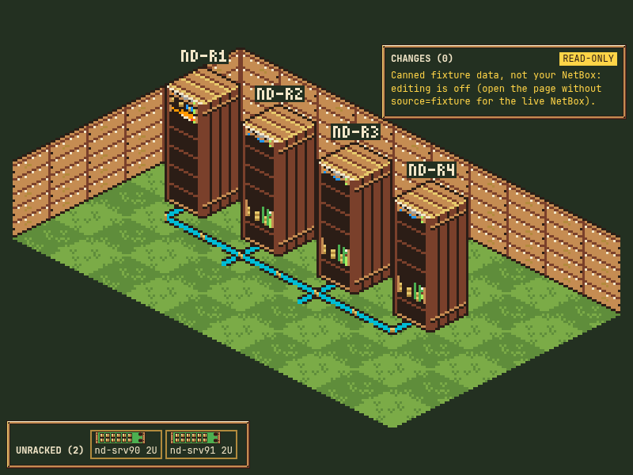
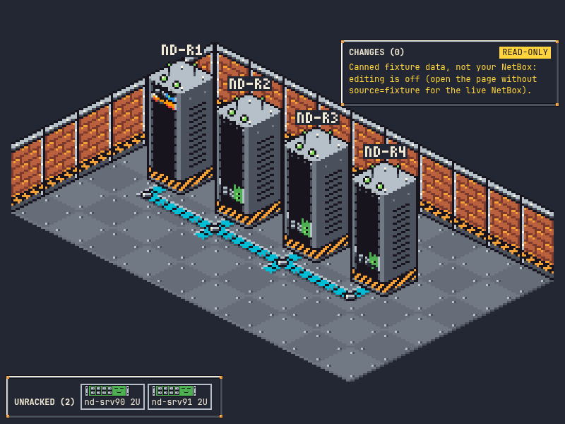
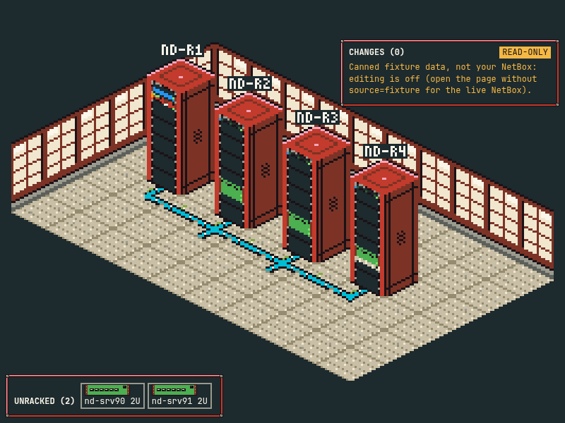
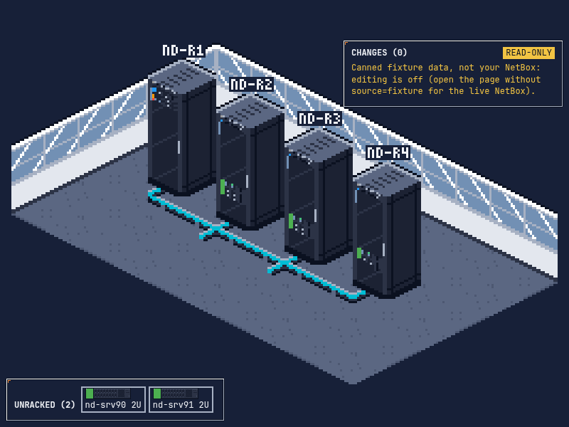

# World of Confusion: RackWalker

The world is full of confusion: unlabelled racks, unknown serials, cables to nowhere.
You are the RackWalker, and your job is to bring order to it.

RackWalker is a locally hosted, browser-based 8/16-bit open-world game that plays on top of your own
[NetBox](https://github.com/netbox-community/netbox) instance. NetBox is the game's database:
- sites become buildings on a GPS-scaled overworld;
- rooms and racks become isometric levels;
- missing data becomes quests.

Fill a gap in NetBox, verified against the real data, to earn XP, potions and tools.

Status: early development. What works today: the game shell (sign in as your NetBox user, a 16-bit overworld
derived from your sites' GPS, with one building per site in its theme, walk through a door into that site's isometric room and back out, Ilatea's first
lines, autosave) on top of the engine: an isometric pixel-art view of a NetBox 4.7 instance (sites placed by GPS,
rooms, racks, devices, cables and cable traces) in four original art themes plus a plain debug theme, with
drag-and-drop edits written back to NetBox after a diff preview.

| Farm | Industrial robotic | Pagodas and nature | Business |
|---|---|---|---|
|  |  |  |  |

Every level of every theme is in [`docs/screenshots/themes/`](docs/screenshots/themes/).

## Planned features
- An overworld you can walk around, with sites placed by GPS. You fly between distant regions from nearby
  airports.
- Enter a building to switch to an isometric room / rack view. You can drag and drop racks and devices,
  and trace cables.
- Quest givers whose quests come from what your NetBox is missing.
- NPCs who quiz you on CLI commands with multiple-choice questions.
- Short, optional survivors-style fights against waves of gremlins, with the occasional boss.
- A character designer, more visual themes, and chiptune music generated in the browser.

Every change to NetBox is shown as a preview before it is applied, and NetBox's changelog is the audit
trail. Game progress is stored by the game, never in NetBox.

## How it fits together

The browser talks only to a small Python proxy; the proxy talks to NetBox and holds the NetBox token, so the
token never reaches the browser, a response body or a log line.

| Path | What |
|---|---|
| `contracts/` | Contract 2.2.0 between the two halves: scene JSON Schema, OpenAPI, API rules, iso conventions, theme manifest (read `contracts/README.md` first) |
| `web/` | The game in the browser: TypeScript + Vite + PixiJS 8, Vitest and Playwright; npm with a pinned `package-lock.json` |
| `proxy/` | FastAPI proxy (`rackwalker_proxy`): typed NetBox client, scene bodies, change preview/apply, read cache, sign-in and the game store (SQLite); pytest; pinned `requirements.lock` |
| `fixtures/` | Canned responses for every route, rendered from the synthetic seed model; the web side can run on them alone |
| `devnetbox/` | Throwaway NetBox v4.7.4 stacks (netbox-docker 5.1.1) in Docker, with an idempotent synthetic seed |
| `docs/` | Art briefs and screenshots |

## Getting started

Needs Python 3.15 (3.14 also works), Node 26 and npm. Docker only for the dev NetBox.

```sh
make bootstrap        # .venv from proxy/requirements.lock, web/node_modules from package-lock.json
make dev-fixtures     # proxy on 127.0.0.1:8710 serving fixtures/, vite on http://127.0.0.1:5173
```

`make` uses a `python3.15` on your `PATH` if there is one, else `python3`; set `PYTHON=/path/to/python3.15` to
choose. `.venv`, `web/node_modules` and the Playwright browsers (`.ms-playwright/`) all live inside the checkout.

With a dev NetBox of your own (local Docker daemon by default; see `devnetbox/README.md`):

```sh
make netbox-reset     # start a throwaway NetBox 4.7.4 on localhost:8100 and seed it (synthetic data only)
make netbox-env       # write .env (mode 600, gitignored) with the proxy user's read-only token
make dev              # proxy against that NetBox, vite on http://127.0.0.1:5173
```

To run the stack on another Docker host, export `DOCKER_HOST` (for example `ssh://user@docker-host`) and set
`NB_HOST=docker-host` for every `make netbox-*` call. `NB_PROJECT` and `NB_PORT` pick a stack name and port, so
several stacks can run side by side.

## Everyday commands

| Command | Does |
|---|---|
| `make test` | proxy pytest + web `tsc --noEmit` + vitest. Validates every fixture against the schema on both sides and checks that generated code is fresh |
| `make e2e` (or `make test-e2e`) | Playwright, headless chromium: golden screenshot per zoom level, pixel-crispness check, interaction, editor, perf (1,000 devices at room level >= 50 fps), and the game shell on a fixture-mode proxy with a fresh game store (screenshots to `docs/screenshots/game/`) |
| `make e2e-themes` | the interaction and editor e2e once per theme (`RACKWALKER_E2E_THEME=<id>` adds `?theme=<id>`; the goldens stay on `debug`) |
| `make theme-shots THEME=<id>` (or `all`) | every zoom level, the theme picker and the slot sheet of one theme into `docs/screenshots/themes/<id>/` |
| `make gen` | regenerate pydantic models, TS types and fixtures from their sources |
| `make dev` / `make dev-fixtures` | proxy + vite against the NetBox in `.env`, or against `fixtures/` |
| `make netbox-up` / `seed` / `reset` / `down` / `destroy` / `status` / `check-fixtures` | manage a dev NetBox stack (`NB_PROJECT`, `NB_PORT`) |
| `make netbox-env` | write `.env` with the stack's URL and the proxy user's **read-only** token and `WRITE_ENABLED=0`; `WRITE=1 FORCE=1` writes the proxy user's write token and `WRITE_ENABLED=1` instead. The admin token never goes to the proxy |
| `make test-live` | proxy contract tests against the dev NetBox (fresh seed): fixture parity, errors, an apply round trip checked in NetBox's changelog, then put back. `RACKWALKER_RECORD=1` also re-records `proxy/tests/recorded/` (the offline replay data `make test` uses) |
| `make e2e-live` (with `make dev` running) | headless chromium on the live stack: all 3 sites on the world view, double-click down to a device, every `/api` answer from NetBox; with `NB_URL` and `NB_ADMIN_TOKEN` of a write-enabled stack also the live write round trip, and with `NB_ADMIN_TOKEN` (or `NB_PLAYER_TOKEN`) the game: sign in as that NetBox user, every door in and out, reload. Screenshots to `docs/screenshots/` |

The live write round trip of `make e2e-live` needs a write-enabled proxy and the stack's admin token (used only by
the test, to read the device and its changelog):

```sh
WRITE=1 FORCE=1 make netbox-env   # .env with the proxy user's write token and WRITE_ENABLED=1; then restart make dev
export NB_URL=$(devnetbox/nb.sh env admin | sed -n 's/^NETBOX_URL=//p')
export NB_ADMIN_TOKEN=$(devnetbox/nb.sh env admin | sed -n 's/^NETBOX_TOKEN=//p')
make e2e-live
```

## The game shell: `web/src/game/`

Open `http://127.0.0.1:5173/` (no `?view=`) with `make dev` or `make dev-fixtures`.

* **Sign in as your NetBox user.** Paste one of your NetBox API tokens (a read-only one is enough; NetBox: your user
  menu, API Tokens). The proxy asks NetBox once who owns it and forgets it; your session is an HttpOnly cookie. In
  the dev stack, `devnetbox/nb.sh env admin` prints a token of the `admin` user; with `make dev-fixtures` use a
  synthetic token from `fixtures/players.json`. `RACKWALKER_LOCAL_PLAYER=1` skips sign-in for a NetBox only you use
  (off by default).
* **Overworld.** A 16-bit tile world (256 x 224, whole-number scaling) made from your sites: sites within 250 km of
  each other share a walkable region with compressed distances, joined by paths over bridges, filled with forest,
  water, fields and the landmarks and animal villagers of the region's country (`Site.country`); one front-facing
  building per site in its theme, labelled with the site's name. Distant regions are reached through an airfield pad
  (a placeholder until flights). How it is built: [`web/art/overworld/README.md`](web/art/overworld/README.md). Walk
  with the arrow keys or WASD (or your own keys), or tap/click where you want to go. Each door has a bobbing marker in
  its doorway, below the building's sign. Walking into a door enters that site's first room; zooming out past the site level (`Esc`,
  the back button or the "World" crumb) leaves the building, and you stand in front of its door.
* **Ilatea** speaks one line on your first visit ("Small things matter"; in a NetBox with no sites yet, she asks you to add one) and then lets you act. She speaks again only
  on your first building, or once if you seem stuck on the green, and never repeats herself. She stands on the green
  near the start: walk up to her and press the interact key, or tap her, to ask what to do next. Her lines name your
  own keys, so they stay right after you remap them. Every bubble closes
  with `Esc` or its close button; the typewriter finishes at the first key or tap; choices work by arrow keys and
  `Enter`, number keys, mouse or touch.
* **Menu** (`M` or the button in the corner): talk to Ilatea, the field-guide pages of her owls Byte (commands and
  hardening) and Nocti (hardware and best practice) as placeholders, settings, sign out.
* **Settings**: Ilatea's hint level (off, low, normal, high), sound (mute, volume; for the music to come), reduce
  motion (text at once, scene changes and zooms cut), and every overworld and menu key remappable (up to three keys
  per action; inside a building every key follows the remap too: back, zoom, enter, search, rotate, trace, unrack and undo). Nothing flashes;
  the selected choice and the doors are marked by shapes, not only colour.
* **Autosave**: your place (overworld tile, or the level and camera inside a building) is saved by the proxy on every
  change of place, so a reload puts you back where you were. No save points. A write that fails (proxy or NetBox down,
  signed out in another tab) shows a notice at the top, is kept and sent again; "Sign in again" there keeps your place.
  If the game cannot load, it says why and offers "Try again"; a building that will not open leaves you at its door.
* **Game state** lives in `data/game.sqlite3` (`RACKWALKER_STATE_DIR` to move it; gitignored), keyed by NetBox user id,
  schema-versioned. It is never written into NetBox. Routes and rules: `contracts/api.md` "Game state".
* **Dialogue scripts** are data: `web/src/game/scripts/*.json`, schema `contracts/dialogue.schema.json`, checked by
  `validateScript` (every `next` names a node, every node is reachable and can reach an end, one line of at most 160
  characters, at most four choices, always one unconditional choice, `{key:<action>}` names a real key action) when
  they load and in `make test`. A line that mentions keys uses `{key:<action>}`, so it names the player's own keys.

`?view=...`, `source=fixture`, `perf=` and `game=0` open the plain viewer as before (no sign-in, the level in the URL).

## The proxy

* Writes to NetBox are refused unless the proxy runs with `WRITE_ENABLED=1`; the default is dry-run. A
  write-enabled proxy previews and applies only for a signed-in player (sign in through the game first; the editor
  sends the session's CSRF header), and each write carries the player and the change set's reason as NetBox's
  `changelog_message` (`rackwalker (<username>): <reason>`). The player's own NetBox permissions are not checked, so
  run a write-enabled proxy only for people who may edit.
* No other site may frame the game, the editor or the proxy (`X-Frame-Options: DENY`, CSP `frame-ancestors 'none'`).
* Reads are cached per route for `RACKWALKER_CACHE_TTL` seconds (default 10, `0` = off); an apply clears the cache.
* The proxy talks to NetBox as its own user (in the dev stacks `rackwalker-proxy`, created by
  `devnetbox/proxy_tokens.py`), which needs: **view** on the object types it reads (sites, locations, racks, devices,
  device types and roles, cables, interfaces, front, rear, console, console server, power ports and outlets, power
  feeds, circuits and circuit terminations) **and on users** (the game checks that a signed-in player's NetBox user
  still exists and is active before every write); **change** on the six it may edit and **add** on racks for a
  write-enabled proxy. Without view on users, nothing the game saves is written, and the game says so. Dev tokens
  expire after 30 days and are re-minted on demand.
* Reads (scenes, devices, cable traces) need no sign-in: the plain viewer (`?view=`) works without one, so anyone who
  can reach the proxy can read what its token may view. Sign-in guards the game's own state and every write; when a
  player's NetBox user is deleted or deactivated, the game ends their session and stops play until someone signs in.
* It answers only `Host: 127.0.0.1` or `localhost` (`RACKWALKER_ALLOWED_HOSTS` to change), so a DNS-rebinding page
  cannot reach it.
* The OpenAPI document is at `/api/openapi.json`; the Swagger UI (`/api/docs`) and ReDoc (`/api/redoc`) pages load
  their scripts from a CDN, so they are served only with `RACKWALKER_DOCS=1` (local development).
* `RACKWALKER_FIXTURES=1` (or a directory) serves `fixtures/` instead of NetBox.
* Game routes (`/api/game/*`): sign-in, session cookie, CSRF header, the SQLite game store; see the game shell above.

## Themes: `web/src/themes/`

| Theme id | Look |
|---|---|
| `debug` | flat engine boxes on a cool grey palette; the default and the palette of the engine goldens |
| `industrial-robotic` | cheerful factory: brick walls with hazard stripes, riveted steel floor, rack cabinets with robot eyes on the lid |
| `farm` | countryside: timber walls, grass floor, wooden cabinets, barns and silos on the overworld |
| `business` | tidy modern office: glass partitions, carpet, black cabinets, office blocks on the overworld |
| `pagodas-nature` | temple garden: paper-screen walls, raked gravel, red lacquer cabinets, pagodas on the overworld |

Every level of every theme is in `docs/screenshots/themes/<id>/`. Every theme draws all 21 sprite slots from its
own original palette, generated by code. The four art themes mark a failed device with a shape cue as well as the
LED colour. A theme passes `tests/theme-conformance.test.ts` (all 21 slots at the declared size and anchor, palette
colours only, no empty sprite, deterministic per `variant.seed`). `sheet.html?theme=<id>` in `make dev` shows the
slot sheet live.

Which theme a level shows: `?theme=<id>` if given; at world level the viewer's global pick; at site level and below
the viewer's pick for that site, else the site's `iso_theme` custom field, else the global pick; else `debug`. The
HUD picker sets the global pick at world level and the per-site pick below it.

## Engine: `web/src/engine/`

| Module | Does |
|---|---|
| `source.ts` | `SceneSource`, the one data interface: `FixtureSceneSource` (fixtures/ via index.json) and `HttpSceneSource` (proxy routes) |
| `projection.ts`, `camera.ts` | tile <-> screen and its inverse, rack elevation; integer-scale camera (pan, zoom at pointer, pinch, fit) |
| `layout.ts` | deterministic auto-layout of unplaced locations and racks (`contracts/iso.md` rules) |
| `scene.ts`, `depth.ts` | one renderer-agnostic scene per zoom level, depth-sorted (ground layer, then objects) |
| `sprites.ts` | every pixel from theme slots (faceplate stacks, zero-U turn, wall mirror, devices on the room-level rack face) |
| `pick.ts` | hit testing on the same sprite buffers (alpha), returns the contract entity |
| `render.ts`, `view.ts`, `transition.ts`, `hud.ts` | one PIXI Container per level built on demand, transitions, input, HUD |

Open `http://127.0.0.1:5173/?view=room:1:1` (`world`, `site:<id>`, `room:<site>:<location>`, `rack:<id>`,
`device:<id>`). The page reads the proxy by default (`source=http`); `source=fixture` shows the canned fixtures and
`perf=<n>` a synthetic site, both **read-only** (a fixture id sent to the proxy would name a real NetBox object).
`anim=0` turns transitions off.

## Editor: `web/src/edit/`

A thin layer over the engine, wired to the proxy's change API. The proxy's `POST /api/changes/preview` is the one
source of validity: the editor only checks "free floor tile" and "free U range" locally for the drag tint.

| Do | How |
|---|---|
| move a rack | room level: drag it to a free tile; `R` or "rotate" turns it (`move_rack`) |
| add a rack | room level: "+ rack" in the tray, click a free tile (`create_rack`, name `NEW-<n>`, editable in its panel) |
| move a device | rack level: drag it to a U; onto a rack name in the tray (first free U there); onto "UNRACKED" (`place_device` / `unplace_device`) |
| rack an unracked device | rack level: drag its chip from the tray onto a U |
| edit fields | select anything: whitelisted fields are inputs; a change goes into the basket (`update_fields`); "open in NetBox" uses the URL the proxy reports |
| trace | device level: select a port, "trace" or `T`; the path stays lit at every level until "clear" |
| apply | optional reason in the basket; a partial write says which ops were written and left the basket. While Apply is in flight the basket is frozen |
| conflict | an op staged on data NetBox has changed since is refused by its lock: "Reload from NetBox" drops it and reads NetBox again |
| find | `/` or the search box in the HUD: sites, rooms, racks and devices by name; the level is in the URL (`?view=`), so reload and Back/Forward work |
| keys | `Esc` cancels a drag, else leaves the add-rack tool, else closes the panel, else clears the trace, else zooms out; `Backspace` zooms out; `Delete` unracks the selected device; `Ctrl+Z` undoes the last staged op; `R` rotates; `T` traces |

The ghost is green when the proxy's preview of basket + candidate says ok, yellow while it checks or when the proxy
is unreachable (local check only), red when either says no; a red drop is not staged. Apply in dry-run (403
`write_disabled`) keeps the basket and says so.

## Rules for this repo

* Synthetic data only: invented names and places, documentation IP ranges (192.0.2.0/24, 198.51.100.0/24,
  203.0.113.0/24, 2001:db8::/32). Never point tests at a real NetBox.
* CI runs on GitHub-hosted runners only (`.github/workflows/ci.yml`); never add a self-hosted runner.
* All art is original and generated by code from palettes; do not imitate any existing game's art, characters,
  names or palettes.
* Never commit tokens: `.env` and `devnetbox/.stacks/` are gitignored.

## Licence
Copyright 2026 the RackWalker contributors. Apache-2.0 (see `LICENSE` and `NOTICE`). NetBox is a trademark of NetBox Labs; this project is not affiliated with it.
