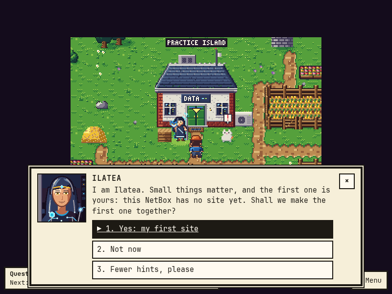
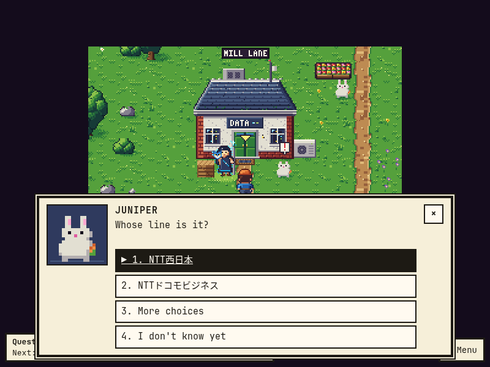
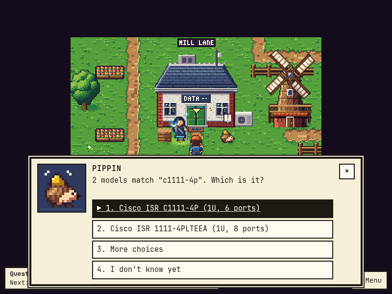
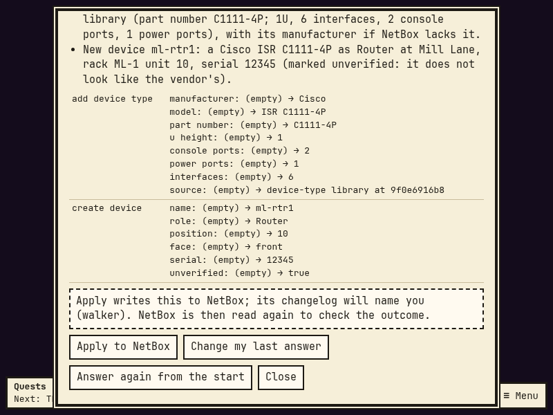
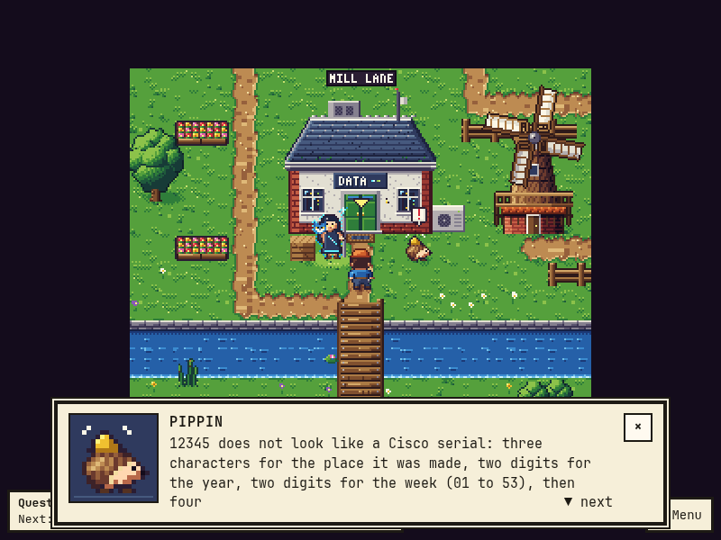
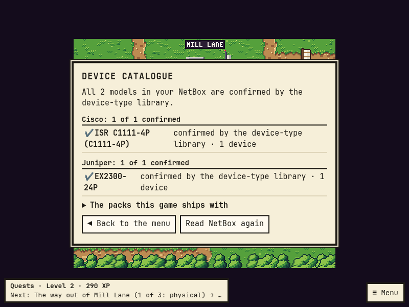
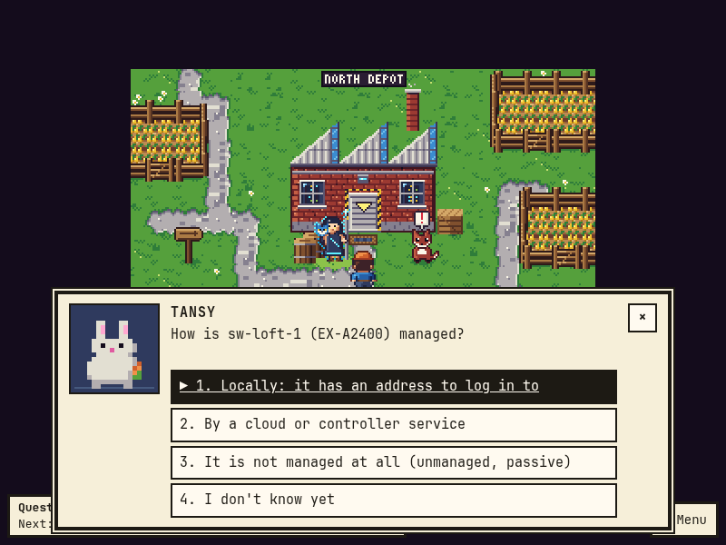
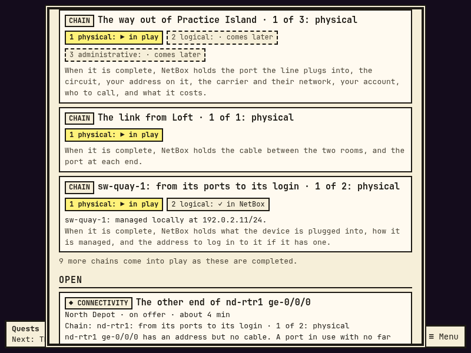
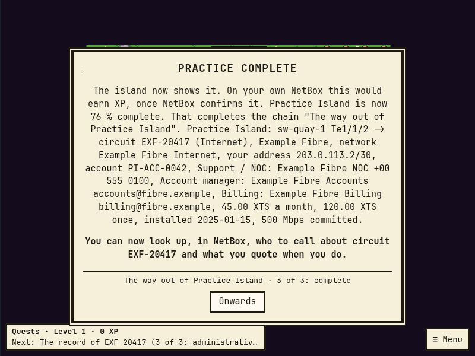

# Quests: what the game looks for in your NetBox, and why

This page is for a NetBox admin. It says what RackWalker reads, what it counts as missing, how it turns that into
questions, and what it writes back. The code is `proxy/rackwalker_proxy/estate.py` (the read), `findings.py` (the
rules), `quests.py` (the questions), `chains.py` (the chains) and `questroutes.py` (the log, the check and the rewards).

A quest is never "fill in field X". The game first looks at the whole estate and works out what you cannot answer
from NetBox today ("how does this site reach the internet?"). It then asks you what you know, a little at a time,
with real names from your own NetBox as the choices. A quest line ends in one change to NetBox that you see before
it is written. It is complete only when NetBox, read again, shows the result: something that merely went away (a
device you deleted) completes nothing and pays nothing.

## A worked example

Say your NetBox has one site, Mill Lane, with two rooms and a rack in each, three switches, and a provider (Northlight
Telecom) with no circuit on record. Nothing is cabled. NetBox looks tidy, and it cannot answer a single question about
how anything connects. The game finds, in this order:

| The game says | It asks | It ends in |
|---|---|---|
| "Nobody can tell from NetBox how Mill Lane reaches the outside world." | Which device does the line to the outside plug into? What is the circuit ID on the bill? What kind of service? Which port? What cable? | a circuit, its end at Mill Lane, a cable; the reward quotes NetBox's own trace from the port to the circuit |
| "Circuit NLT-7001 from Northlight Telecom plugs into ml-sw1 Te1/1/1, but NetBox has no address on that port." | Does that port carry an address of yours? Which, with its mask? Record its subnet too? | the address on the port, and its prefix |
| "Circuit NLT-7001 ... is plugged in at Mill Lane, but NetBox does not hold the provider's network it lands on, the account ..." | Which network of theirs? Which account? Who do you call? Install date and commit rate? What does it cost? Each "if known" | the provider network and account, up to three contacts with their roles, the circuit's dates, rate and charges |
| "Comms Room and Store Room at Mill Lane have no link between them." | Which device in the Store Room has the link? What does it connect to in the Comms Room? Which ports? | a cable; you can trace from one room to the other |
| "ml-sw2 has 24 ports and nothing recorded on any of them." | What is it plugged into? Which port (the fibre cages and the highest-numbered ports are offered first)? | a cable |
| "NetBox does not say how ml-sw2 is managed, or how to reach it." | How is it managed: locally, by a cloud or controller service, or not at all? Only if locally: which address, on which interface? | how the device is managed, and its primary IP if it has one |
| "ml-sw1 and ml-sw2 in rack ML-C1 have no serial number on record." | One form for the rack; blank is "could not read it" | the serials you read |

Every answer you do not have is a field task with a checklist ("Find ml-sw2: rack ML-C1 U20 in Comms Room. Follow the
cable from its uplink port..."). When the lines are done, NetBox can answer what it could not: the trace from a switch
port reaches the carrier's circuit.

The first three rows are one **chain** ("The way out of Mill Lane": physical, logical, administrative): once you have
begun it, its next stage is offered before anything else. It ends with the
whole record read back from NetBox in one sentence: "Mill Lane: ml-sw1 Te1/1/1 -> circuit NLT-7001 (Internet), Northlight
Telecom, network Northlight Internet, your address 203.0.113.2/30, account 44-1021, Support / NOC: Northlight NOC 0800 000
0000, 240.00 GBP a month, installed 2024-03-01, 100 Mbps committed." See "Chains" below.

## What the game reads

One bounded read of NetBox with the proxy's own token (view permission only):

| Read | Used for |
|---|---|
| sites, locations, racks | where things are; GPS, facility and country of a site; a rack's room and floor position |
| devices with role, device type, platform, status, serial, asset tag, primary IP, rack and unit, virtual chassis, and the custom fields `rw_mgmt_mode` and `rw_mgmt_service` (on the device type: `rw_mgmt_default`) | what each box is and where; which switches are one stack; how each is managed |
| interfaces, front and rear ports (with the positions of a rear port, and the position each front port maps to), power ports, power outlets | what can take a cable, and which of them have one |
| cables with both ends | the connectivity graph and the power graph |
| circuits (with status, provider account, install date, commit rate and the custom fields `rw_mrc`, `rw_nrc`, `rw_currency`), providers, circuit types, circuit terminations (at a site, in a room of a site, or on a provider network) | the way out of a site, and links between sites |
| provider accounts, provider networks, contacts, contact roles, and the contact assignments of providers and circuits | a circuit's administrative record |
| IP addresses, prefixes, each with its VRF | which interface has an address, and whether a prefix of the same VRF holds it |
| power feeds, platforms (with the manufacturer a platform is tied to) | choices offered in a question |
| every device type (manufacturer, model, part number, tags) and device role, the tags of each device, each provider's AS numbers, and the module bays of the devices with what is fitted in them | the setup lines below, the device catalogue, and matching what NetBox already holds so nothing is made twice |

It also reads when NetBox last changed each site, rack and device (`last_updated`). A change a quest proposes to one
of them carries that time, so NetBox refuses it if someone has changed the object since the question was asked: a
line about an empty serial never writes over a serial a colleague recorded a minute ago.

Each list is read with a small field selection, page by page, up to a cap (20,000 devices, 200,000 ports, 100,000
cables, 100,000 addresses), four lists at a time: NetBox is never asked for all of them at once. The result is kept
for 60 seconds (`RACKWALKER_ESTATE_TTL`).

**How often NetBox is read.** The whole estate is read at most once per 60 seconds, and never twice at the same time.
After a quest writes, only the sites that change reached are read again (their devices, ports, cables, racks and
addresses, plus the small estate-wide lists: sites, circuits and their ends, providers, platforms, prefixes) and put
into the kept estate (a model's default reaches every site, so after one is written the whole estate is read). If something that was at those sites is not in that read (it was deleted, or moved to another
site), the whole estate is read instead. "Check NetBox" on a line reads that line's site, at most every 5 seconds; "Read NetBox again"
in the quest log reads the whole estate, at most every 15 seconds. Asked sooner, the game answers from what it has. A
change made in the room editor drops the kept estate, so the next look reads it whole.

**When the game could not look.** If a list hits its cap, or NetBox refuses it to the proxy's token, the rules that
need it say nothing: the game never calls something missing only because it could not look. The gap list and the
quest log name such lists in `incomplete`. While any list is incomplete, no site is shown above 99 %, no site's
Confusion is ready, nothing is "all in order", and no spot check is offered: the picture is not whole.

**The connectivity graph.** Every interface of a network device belongs to that device, so traffic passes through
it. Anything else (a server, a wireless access point, a box whose role says nothing and that has no row of ports) is
an end, not a way through: two switches that share only a dual-homed server are not linked. The members of a virtual
chassis (a switch stack) are one switch. A patch panel's front port joins the *position* of the rear port it maps to:
the strands of a trunk are separate wires, so two switches on two strands of one trunk are not linked by it, and a
trunk joins strand 1 to strand 1. A cable joins its two ends. A circuit joins its terminations, and every circuit that
ends on one provider network is joined to the others on it (sites that hang off one MPLS or SD-WAN service are
linked through it). A decommissioned circuit joins nothing. Two devices are "connected" when a path of these joins
them. Power ports, outlets and feeds are a separate graph.

**Which devices count.** Rules about connections, power and addresses look only at devices whose status is
`active` or `staged`. What a device is comes from its role's name and slug, read word by word (so "tor" is a role,
and is not found inside "storage"):

| A device is | when a word of its role is (or, for the longer words, starts with) |
|---|---|
| a *network device* | switch, router, firewall, core, access, distribution, gateway, wan, edge, spine, leaf, tor, network, aggregation, agg |
| a router | router, gateway, wan, edge, firewall |
| *passive* | patch, panel, pdu, power, cable, shelf, blank |
| wireless | ap, aps, wireless, wifi, wlan, or "access" together with "point" (never a network device: nothing uplinks to an access point) |
| an *end host* | wireless, or server, host, storage, hypervisor, compute, workstation, desktop, printer, camera, phone, nas, san |

A role these words do not know ("Kit", "Blue") still makes a network device when the device has eight or more
physical interfaces: a box with a row of ports is a switch, whatever its role is called. So the headline findings do
not depend on how you named your roles.

**A switch stack is one switch.** Its cables, its uplink and its management address are the stack's: a member with
nothing of its own plugged in is not "connected to nothing", a member is not "cut off" from its own stack, and the
stack is asked for one management address, not one per member. Its first live member speaks for it (a stack whose
first member is switched off is still a switch). What any member says about how it is managed settles the stack;
"managed locally" with no address on any member still asks for the address.

## Findings: the whole picture

A finding is something more than one field is needed to see. Each has a stable id
(`<kind>:<object type>:<object id>`), the objects that show it, and a value rank. The rank decides the order in
which quests are offered: **connectivity** (can it be reached, and how) before **identity** (which box is it) before
**layout** (where it stands). Inside a rank the order is the order of this table.

| Kind | Rank | The game reports it when | Why it matters to you | The question it asks | The change it ends in |
|---|---|---|---|---|---|
| `estate_no_site` | connectivity | NetBox has no site at all (the line is about the estate, not a site: Ilatea asks it, and the quest log lists it) | everything in NetBox hangs off a site | the country, then the site's name | a site, with the region of its country (created when missing) |
| `site_no_rack` | connectivity | a site has no rack and no device | devices need somewhere to stand | what the kit stands in (a rack of which height), and what is written on it. "No rack: it stands on a shelf or on the wall" is an answer | a rack |
| `site_no_devices` | connectivity | a site has no device | nothing can be cabled or traced before the boxes are on record | for each box, up to three in one pass (`site_more_devices` then offers the next ones): what is printed on it (searched in the device-type library), what it does, its name, its unit and its serial | the device type, imported from the library with its ports if NetBox lacks it; the device, and its role if NetBox lacks it |
| `site_no_provider` | connectivity | the estate is just starting (no provider, no circuit and no cable on record, at most 12 devices): reported at each site | nobody can tell whose line the site is on | "Whose line is it?", from the provider pack of the site's country (see "Whose line is it?" below). "We do not keep carriers in NetBox" is an answer | a provider, with its AS numbers |
| `site_no_way_out` | connectivity | a site has network devices, a provider or circuit is on record, and no finished circuit to the outside that is cabled to a device can be reached from the site (a circuit with an end recorded at a site and no cable on it is not finished; a private line between two of your own sites is a link between them, not a way out; a decommissioned circuit is nothing). Not reported while a circuit end is on record at this site with no cable: `circuit_unterminated` asks that, once | nobody can tell how the site reaches the internet | which device the carrier's line plugs into, whose line (asked even with one provider on record), which circuit (or its ID, typed from the bill), which port, what cable. "No line out, on purpose" is an answer | a circuit if it is new, its termination at the site, a cable |
| `sites_not_linked` | connectivity | the estate has two or more sites with network devices, and no path joins this site to any other (a path may run through a provider network both sites have a circuit on). Not reported at the sites of a circuit between them that has an end with no cable: `circuit_unterminated` asks that, once | nobody can tell how the sites reach each other | which device has the link, what it connects to, both ports, the cable. "No link, on purpose" is an answer | a cable (and a circuit termination, for a circuit) |
| `locations_not_linked` | connectivity | two rooms of one site each hold network devices, and no path joins them | if the link between the rooms fails, nobody knows which cable to check | the same, between the two rooms | a cable |
| `site_island` | connectivity | cabled network devices of a site form two or more groups with no path between them (unless every room of the smaller group is already reported by `locations_not_linked`) | a group of devices is cut off on paper from the rest of the site | what a device of the smaller group connects to in the main group | a cable |
| `switch_no_uplink` | connectivity | a switch has cables, but none of them leads to another network device or a circuit | when the switch goes quiet, nobody can tell what sits above it | what it uplinks to, both ports, the cable | a cable |
| `circuit_unterminated` | connectivity | a circuit has no termination that is cabled to anything, or has an end recorded at a site with no cable on it, or is cabled only as far as a patch panel that leads to no device | a circuit you pay for ends nowhere | which site it comes into, which device, which port; for a line that stops at a panel, which device it goes on to | a termination if needed, a cable |
| `provider_unused` | connectivity | a provider has no circuit at all (and no site is waiting for a way out) | a carrier is on record with nothing of theirs recorded | which site their line comes into, then as for `site_no_way_out`. "We no longer use them" is an answer | a circuit, its termination, a cable |
| `circuit_handoff` | connectivity | a circuit is cabled to an interface of one of your devices (directly, or through patch panels: a demarc panel, then a lead to the router), and that interface has no address | nobody can tell which subnet is the carrier's | whether that port carries an address of yours, which (with its mask), and whether to record its subnet. "No address there: bridged, or theirs to hold" is an answer | an address on that interface (never the primary IP), and a prefix if you say so |
| `circuit_record` | connectivity | a circuit is cabled to one of your devices, and NetBox lacks one of: a provider network at its far end, its provider account, one of its three contacts (support, account manager, billing; on the circuit or on its provider), its install date, its commit rate, its monthly charge, its one-off charge (see "A circuit's record") | when the line is down you need to know who to call and what to quote | each fact in turn, each "if known": "I don't know yet" on one leaves the others to be written | a provider network and the circuit's end on it, a provider account, contacts and their assignments, the circuit's own fields |
| `device_unconnected` | connectivity | a live device that is not passive has physical interfaces and no cable on any of them | if it drops off the network, nobody can tell which port to check | "What is sw-north-1 (rack N1 U20 in Comms Room) plugged into?" then both ports and the cable | a cable |
| `router_no_address` | connectivity | a router or firewall has no IP address on any interface | NetBox cannot say on which address it routes | how you reach it: an address it already has, or one you type, and its interface | an IP address on the interface, set as primary |
| `interface_no_cable` | connectivity | see "Expected cables" below (one finding per device, for all of its such ports) | ports are marked as in use, with no record of their far ends | for several ports, first what they are: "desk and wall-outlet leads, not kept in NetBox" answers all of them at once. Else, a few ports at a time: what is on the other end, the far port, the cable. "The port is not in use" is an answer per port | a cable per port you knew |
| `device_no_power` | connectivity | devices with power ports have no power cable, while other devices at the site do (one finding per rack) | if a power strip trips, nobody can tell what goes dark | which power strip each device is plugged into, and which outlet | a power cable per device |
| `device_unreachable` | connectivity | a live device that is not passive has no primary IP, and NetBox does not say that a cloud or controller service manages it or that it is not managed (one finding per device; see "How a device is managed") | when something breaks, the first question is how to get at it | first how it is managed; only for a locally managed device: one of its addresses, or a typed one and its interface | how the device is managed (and optionally its model's default), and the primary IP if it has one |
| `address_no_prefix` | connectivity | addresses on a site's interfaces lie in no prefix of their own VRF (one finding per implied subnet and VRF; all host addresses, /32 or /128, of one VRF are one finding) | addresses with no prefix cannot be planned around | "their mask says the subnet is 192.0.2.0/24. Is that right?" or the right one, typed. For host addresses the range is asked for, never guessed. For an address in a VRF the game does not write: it says which prefix to add to which VRF, and "Check NetBox" completes the line | a prefix (global table only) |
| `device_type_unknown` | identity | a live device's model or manufacturer is a placeholder ("Unknown", "Generic", "TBD", "Placeholder", "Other" and the like), and the device-type library holds no model under exactly that name (a patch panel the library files under the maker "Generic" is a model) | without its model nobody knows its ports, its height or its support contract | "What is this box?": what is printed on it, searched in the device-type library. "It really is a generic box: leave it" is an answer | the device type (imported if NetBox lacks it) and the device's change to it, only where nothing recorded is lost (`docs/packs.md`) |
| `device_type_part_number` | identity | a device type that live devices are made of is a model the device-type library holds, and NetBox has either no part number for it or the part number the library lists for **another** model of that maker (one finding per model, at the site of its first device; not for a model marked unverified). A part number the library merely does not list is not asked about: a model is sold under several (a region, a licence bundle, a machine type) and the library lists one. A library part number that stands for several ("7X0x") is never offered | a spare ordered by the wrong part number is the wrong spare | "sw1 is a Juniper MX204. What part number is on its label?": the library's number, "something else" (typed; if it is the part number of another model the line says which, and that the device's type is what is wrong; if the library does not list it, nothing is written and the line says where to record it yourself), or "leave it" (nothing is written, no XP) | the device type's part number, in the library's spelling; nothing else is ever written by this line |
| `rack_audit` | identity | devices in one rack lack a serial or an asset tag | a device with no serial cannot be matched to a support contract | one form for the rack, top to bottom; leave blank what you cannot read | the fields you filled in, per device |
| `shelf_audit` | identity | the same, for devices that are in no rack (per room) | the same | one form for the devices outside the racks of that room | the fields you filled in |
| `module_bays_unrecorded` | identity | a live device has module bays and NetBox shows nothing in any of them | power supplies, fans and line cards fail one at a time | which bay has something fitted, what is printed on the module (searched in the library's module types; one the library lacks is recorded by hand and marked unverified), its serial. "Nothing is fitted: the bays are empty" is an answer | the module type (imported if NetBox lacks it) and the module in that bay |
| `platform_survey` | identity | devices of one model at a site have no platform (one finding per model, at most 20 devices each) | when an advisory or an upgrade comes out, nobody can list what runs it | "4 EX-A2400 devices have no platform on record: ... What do they run?" One answer covers them all; "They do not all run the same" asks about each. Only platforms NetBox allows for the model's manufacturer are offered | the platform of each device |
| `site_record` | identity | a site lacks GPS, a facility name or a country | it cannot be put on a map or named to a carrier | one form: latitude and longitude, facility, country code | the site fields you filled in |
| `site_more_devices` | identity | a site that is still being set up (1 to 11 devices, none of them cabled yet); optional: it is offered beside the site's other lines, and it is never part of the site's completeness | a box NetBox does not hold is a box nobody can plan around | "NetBox holds 3 of the boxes at Mill Lane. Is there one it does not hold yet?" Then, as for the first boxes, up to three in one pass. "No: NetBox holds every box here" closes it; it is offered again only when the count of devices at the site changes | the same as `site_no_devices` |
| `rack_devices_unpositioned` | layout | devices are in a rack with no rack unit | nobody can be sent to the right unit | one form: the lowest unit of each device | each device's unit |
| `room_layout` | layout | racks have no room (only at a site that has rooms on record), or no place on the floor plan (`iso_x`, `iso_y`) | someone new cannot find the rack | one form: the room, and the floor tile (or drag the rack in the room view) | each rack's room and floor position |

A finding about a group (an island of switches, a set of addresses) is named after the group's first member and keeps
one check per member. When the first member goes away, the same unfixed problem has a new id; a line you had begun
goes with it, with your answers.

A quest opens with the finding's own sentence, so the first thing a quest giver says is what is missing and where,
with the names NetBox has ("Comms Room and Store Room at Mill Lane have no link between them."), then why it matters.

A site with none of these gets a short, honest "All in order": the game does not invent work. The only thing its
quest giver then offers is a **spot check** of one device at a time ("is sw-quay-1 still in rack PI-Q1 U10, serial
...?"). "Yes" closes it with nothing written and no XP; "no" is a field task: correct the record, then say it matches.
A spot check exists only at a site with nothing open; asked for anywhere else it is refused.

Not in this version: a VLAN check (a prefix with no VLAN behind it; the logical stage of a chain records addresses and
prefixes, not VLANs), and console ports.

## Setting a NetBox up

The game also helps where NetBox is empty or nearly so. The first four rows of the table above are a chain,
"Setting up <site>": a new admin gets a usable NetBox by playing it. What it offers comes from the packs the game
ships with ([`docs/packs.md`](packs.md) says what is in them, where each fact came from and how to add a country).

| Stage | Line | It asks | It ends in |
|---|---|---|---|
| (before any site) | `estate_no_site` | the country, the site's name | the site |
| 1 room | `site_no_rack` | what the kit stands in | a rack |
| 2 kit | `site_no_devices` | what is printed on each box, what it does, its name, unit and serial | the boxes, each with the ports of its model |
| 3 carrier | `site_no_provider` | whose line the site is on | the provider |

After that the game goes on to what it has always asked ("how does this site reach the outside?"), with the carrier
now on record. In a live empty NetBox 4.7.4 the whole way, from no site to a circuit that NetBox traces from the
router's port, is 21 answers and five previewed changes; the proxy's own share of that is a few seconds, and reading
the labels is the rest (`make test-live-empty` plays and times it).

**"Whose line is it?"** The choices are, in this order: the providers NetBox already holds; the providers of the
pack of the site's country that NetBox does not hold yet, by name; "Another provider: search by name", which looks
in NetBox and in every pack by name, by another name the provider goes by, or by AS number (a provider your NetBox
holds under another name than the pack's, "British Telecom" for "BT", is found by either and offered as yours); "My provider is not
listed", which takes the name as you type it; and "I don't know yet". A provider is created only when you apply the
previewed change, with its AS numbers as NetBox ASN objects. A pack entry that NetBox already holds, under the same
name or with the same AS number, is that provider: it is used, and never made twice. Names are compared in any
script and with their spacing left out ("AT & T" is "AT&T"; "МТС" is not "Ростелеком"). Where NetBox holds one
network under two names (two providers with one AS number) and neither is the pack's name, the line asks which.
A site with no country on record, or in a country with no pack yet, says so and offers the search.
The search shows the site's own country first, then the international names, then other countries with their code;
[`docs/packs.md`](packs.md#how-the-game-finds-a-provider-among-fifty-packs) has the rules.

In a country whose providers trade under names in another script, the choices are those names as they stand on the
bill; the search finds them by their Latin names too.

**"What is this box?"** You type what is printed on the box: the model, the part number, or part of either; what a
label adds (an order suffix, "-EU", "V05", the word "Series") is let go when nothing else matches. The
choices are the matches in the device-type library (and matching models your NetBox holds that the library does
not). A model your NetBox already holds is shown as it stands there, under your own spelling of its maker
("Juniper Networks EX2300-24P (in NetBox: 24 ports)") and is used as it is; one it holds with no port on it ("in
NetBox: no ports") gets its ports from the library in the same previewed change. The last choices are "None of these: search again",
"It is not in the library: record it by hand" and "I don't know yet". A
model from the library is imported with its interface, console, power and module-bay templates, so the device gets
its ports. A model recorded by hand is marked unverified and earns no bonus. The search works offline; the import
itself needs the internet or a local copy of the library, and says so when it has neither.

**Serials and part numbers are checked.** A part number that contradicts the library's for that model is refused,
with what was expected. A serial that is another device's is refused. A serial that does not look like its vendor's
(only where the vendor itself publishes the format) is asked about once and, if you confirm it, recorded and marked
unverified. `docs/packs.md` has the rules and their sources.

**The device catalogue** (Menu > Device catalogue) lists the manufacturers and models of your own NetBox as a
collection: a tick where the device-type library confirms the maker, the model and the part number, a question mark
where it does not, and a "differs" mark where the part numbers disagree. It is derived from NetBox each time it is
opened; the game only remembers when it first saw each model. It counts what your NetBox holds and nothing else:
there is no target to reach, no timer, and nothing is lost by ignoring it.

## Gaps: single empty fields

The gap scanner (`GET /api/quests/gaps/<site id>`, paged, in a fixed order) lists single empty fields. A gap's id is
`<object type>:<object id>:<field>`, so it stays the same from one scan to the next.

| Gap id | Listed when |
|---|---|
| `device:<id>:serial` | the device has no serial number and is not passive (patch panels, shelves and blanking plates often carry none) |
| `device:<id>:asset_tag` | the device has no asset tag, **and at least one device in NetBox has one** (if nobody uses asset tags, their absence is not a gap) |
| `device:<id>:platform` | the device has no platform, it is not passive, **and NetBox has at least one platform** |
| `device:<id>:primary_ip` | a live device that is not passive has no primary IP, unless NetBox says a cloud or controller service manages it or that it is not managed (a stack: one check, on its first live member; any member's answer or address settles it) |
| `rack:<id>:location` | the rack is in no location (room), at a site that has locations on record |
| `rack:<id>:iso` | the rack has no `iso_x` or no `iso_y` |
| `interface:<id>:cable` | see "Expected cables" |
| `site:<id>:gps`, `:facility`, `:country` | the site has no latitude or longitude, no facility, no country |

Gaps are never offered one at a time. They are bundled into the errands above: one rack, one shelf, one site, one
room. A quest takes at most four devices or racks, so it stays a few minutes long.

### Expected cables

A switch with 24 ports and three cables does not have 21 gaps: an unused port is normal. An interface is expected to
have a cable only when NetBox already says it is in use:

* it is enabled and physical (not virtual, bridge, LAG or wireless), on a live device that is in a rack and already
  has at least one cable; **and**
* it has a description, **or** it carries an IP address and is not a management-only port, and that address is not
  the management address of a device recorded as locally managed (on the device itself, or as the default of its
  model); **and**
* it has no cable and is not marked as connected (`mark_connected`).

An address on a management-only port does not ask for a cable. It says how the device is reached, not that a lead in
that port goes somewhere NetBox should know: management networks are often left out of NetBox on purpose, and the
line "how is it managed" has just put that address there. The same holds for a switch with no management port and no
VLAN interface: when you say it is managed locally and name the front-panel port that carries its management
address, that port is not listed as uncabled because of that address. A device that has "local" from its model's
default is treated the same. (A device with a primary IP and nothing recorded about how it is managed keeps the plain
rule: an addressed front-panel port is a port in use.) Describe the port ("to the out-of-band
switch") and the game asks where it goes.

## How a device is managed

Not every device has an address to log in to. A cloud-managed access point or switch is looked after in its vendor's
portal; an unmanaged switch is looked after by nobody. Some models can be either, by the owner's choice. So the game
never asks "what is its management address" first. It asks **how the device is managed**:

| Answer | What NetBox then holds | What the game expects |
|---|---|---|
| Locally: it has an address to log in to | `rw_mgmt_mode` = `local` on the device | a primary IP: asked next (one of its addresses, or a typed one and the interface that carries it) |
| By a cloud or controller service | `rw_mgmt_mode` = `cloud`, and the service's name in `rw_mgmt_service` (free text; services already on record are offered as choices) | no address: the device is complete for management |
| It is not managed at all (unmanaged, passive) | `rw_mgmt_mode` = `unmanaged` | no address: complete |

* **Asked once per model, where that is true.** When NetBox has more than one device of the model, the game asks "are
  they all managed that way?". "Yes" also writes the model's default (`rw_mgmt_default` on the device type), and no
  other device of the model is asked again. "No, it differs from device to device" writes `varies` there, and each
  device is asked for itself, without that question. A device's own value always wins over its model's default.
* **What NetBox already says is not asked.** A device with a primary IP is locally managed: nothing is asked.
* **A stack** is managed as one: its first live member is asked.
* **"I don't know yet"** parks the line. On the address of a locally managed device it still writes what you did know
  (that it is managed locally), and says so; the address is asked for when you come back.
* **"An interface that is not in NetBox yet."** A switch that has only its front-panel ports in NetBox (what a device
  type from the community library gives) carries its management address on a VLAN or management interface NetBox does
  not have. That is an answer: the game writes that the device is managed locally, tells you to add the interface, and
  never pins the address on a port that does not carry it.
* **Without the custom fields** (see "Custom fields the game uses") NetBox cannot hold the answer. The game then
  remembers "cloud" and "not managed" for you alone, writes nothing, and counts the device as answered for you; the
  quest log says once what is missing.
* **Answers from before this rule.** "It has none: nobody logs in to it" from an earlier version is kept as "it is not
  managed at all": it still counts as answered, and the line now offers to write it to the device.

## A circuit's record

Once a circuit is plugged in, two more lines ask about it. Where each fact lives in NetBox:

| Fact | Where NetBox holds it | Why there |
|---|---|---|
| your address on the line | an IP address on the interface the circuit is cabled to (never made the primary IP); its prefix | NetBox's own model |
| whose line it is | the circuit's provider (already on record with the circuit) | NetBox's own model |
| the network of theirs it lands on | a provider network, and the circuit's far end (side Z) terminated on it | NetBox's own model for "a circuit ends in the provider's cloud". Not asked when both ends of the circuit are at your own sites |
| the account | a provider account, set as the circuit's provider account | NetBox's own model; one account serves many circuits |
| who to call: support or NOC, the account manager, billing (three facts) | contacts, assigned to the provider (for all of its circuits) or to the circuit, each with its contact role | NetBox's own contacts; the roles are NetBox's contact roles, found by a whole word of their name or slug ("support", "noc", "technical"; "account", "sales"; "billing", "finance", "accounting", ...), never by a part of a word: "Accounting" is billing, not the account manager. Each is a fact of its own: a support desk on record does not say who sends the bill. One desk in two roles is one contact, assigned twice |
| install date, commit rate | the circuit's own `install_date` and `commit_rate` (asked in Mbps, stored in kbps as NetBox does) | NetBox's own fields |
| monthly charge (MRC), one-off charge (NRC), currency | custom fields `rw_mrc`, `rw_nrc` (decimal) and `rw_currency` (three letters) on the circuit | NetBox has no field for a charge. On the circuit, because the charge is per circuit; a decimal, so no float rounding; the currency beside it, because a number without one is not an amount |

* **Each fact is "if known".** "I don't know yet" on one fact, or a field left blank in a form, leaves the others to be
  written. A blank field is "not known yet" at once: it is not asked for a second time. The line then waits at the
  first such question, with a checklist ("Find a bill or the contract of Northlight Telecom..."), and the chain says
  so: "3 of 3: administrative (not known yet: the billing contact and the monthly charge)".
* **"None, on purpose"** is an answer per fact: no account number, no charge of its own, and per contact ("there is
  none" beside each of the three, or "nobody else" for those left): a line with a support desk and no account manager
  can be finished.
* **Filled in, never written over.** A fact NetBox already holds is not asked for, is no part of the line (what NetBox
  held all along is never confirmed or paid under it), and a change that would replace a value somebody recorded
  meanwhile is refused. A currency NetBox already holds for the circuit is used, not asked for again.
* **A name NetBox already has.** NetBox keeps one contact per name. When you type a contact whose name NetBox has, the
  game asks whether that contact is the one you mean and says that NetBox keeps the phone and email it has. "No"
  takes you back to give yours a name that tells them apart. It never swaps in the other contact in silence.
* **Your figures stay yours.** An account number, a charge and a contact's details go from your keyboard to NetBox and
  nowhere else: the proxy keeps them in memory until you press Apply, never in the game's own store and never in a
  log, and never puts them in a URL. The store records only which facts a form left blank or answered "there is
  none". (If the proxy restarts before you apply, that question is asked again.) The
  practice island takes no typed figure at all: its questions offer only what the island's made-up bill says (the
  account, the contacts, the install date and commit rate, the charges).
* **Shown only to who may see them in NetBox.** The proxy reads NetBox with its own token. An account number, a
  contact's name and details, a charge, an install date and a commit rate that NetBox holds are shown (in a chain's
  summary, as choices) only to a player whose own NetBox user may view provider accounts, contacts and circuits (an
  unconstrained `view` permission). Anyone else reads "an account on record". The same holds for `POST
  /api/changes/preview`: a change to a circuit's record is planned only for a signed-in player with those permissions,
  on a dry-run proxy too, because a plan answers with what NetBox holds.
* **What NetBox cannot hold is not asked.** Without the cost fields the charges are not part of the record. A contact
  is recorded with its role, so a contact whose role your NetBox lacks (support, account manager or billing) is not
  asked for or counted; with none of the three, the quest log says which roles to add.

## Chains

Quest lines about one subject form a chain: a short series of stages that takes you from knowing nothing about it to
a complete record.

| Stage | What it settles |
|---|---|
| 1 physical | what is plugged into what: the device, the port, the cable, the circuit's end |
| 2 logical | the addresses on it, and how the device is managed |
| 3 administrative | whose it is and what stands on paper: the provider's network, the account, who to call, the install date and commit rate, the charges; for a rack, the labels that match its kit to the paperwork |

| Chain | Physical | Logical | Administrative |
|---|---|---|---|
| a site's way out | `site_no_way_out`, `circuit_unterminated` | `circuit_handoff` | `circuit_record` |
| a site's link to the other sites | `sites_not_linked`, `circuit_unterminated` | `circuit_handoff` | `circuit_record` (for a circuit between two of your sites, held with the site at its A end) |
| the link between two rooms | `locations_not_linked` | (a cable in your own building has no carrier and no bill: one stage) | |
| a device | `device_unconnected`, `switch_no_uplink`, `interface_no_cable` | `device_unreachable`, `router_no_address` | |
| a rack | `rack_devices_unpositioned`, `room_layout`, `device_no_power` | | `rack_audit` |

Setting a site up is a chain of its own, with its own three stages: room (`site_no_rack`), kit (`site_no_devices`)
and carrier (`site_no_provider`). It exists only while one of them is open, and pays stage by stage with no bonus:
the way out, which follows it, has its own.

The other lines (`site_island`, `provider_unused`, `address_no_prefix`, `shelf_audit`, `platform_survey`,
`site_record`, `estate_no_site`, `device_type_unknown`, `device_type_part_number`, `module_bays_unrecorded`, `site_more_devices`) belong to no chain and are offered
as before.

* **Derived from NetBox, never stored.** A stage NetBox already satisfies is shown as done and never asked: a switch
  whose management address is on record starts its chain at "physical", with "logical" ticked.
* **A later stage unlocks** when every earlier one is done in NetBox or was answered, also with "I don't know yet":
  that is a full answer and stops nothing. An admin who holds the bill can record it before anyone has found the
  address, and one who knows a switch is cloud-managed can say so before anyone has walked to the rack. A stage nobody
  has answered yet keeps the next one locked. (A line you had already begun stays in your log.)
* **Where you are** is said everywhere: on the quest ("2 of 3: logical"), in the quest log (each chain with its
  stages: in NetBox, answered, in play, comes later, not known yet), on the marker, and by the quest giver when a
  later stage comes up ("Next in "The way out of Mill Lane": 2 of 3: logical."). The log also says what NetBox will
  hold when the chain is complete, from the stages that chain has (a link that is a plain cable promises no carrier
  and no bill), and what the whole record is worth on top of its stages.
* **The closing summary.** When the last stage is confirmed, the game reads the whole record back from NetBox and
  says it in one sentence (see the example at the top). The summary is always what NetBox holds, never what you typed.
  
* **Order and pacing.** A site's lines are offered most valuable first, as before: the way out and the links, and the
  stages that continue them, before devices, before racks. A connection you have begun to record is carried on first:
  after its cable comes its address, then its paperwork, before another line is started. At most three lines are on offer at a site, so at most three
  chains are in play there; the others are counted in the log. A stage is one line of two to five minutes.
* **Not known is not a fault.** Facts of a circuit's record that you answered "I don't know yet" stay listed as open
  questions, in the chain and in the quest log, and the line waits for them. They do **not** count against the site's
  completeness: a site can reach 100 % and its Confusion can appear while "what does the line cost" is still open.
  (A fact nobody has been asked about yet does count: the game wants every question put once.) This is per player,
  like "that is how it is".

At most three such gaps are listed per device and 50 per site in the gap list; the rest are counted (`unlisted`) and
still count against the site's completeness. The quest line of a device covers all of its ports, listed or not, so a
switch with twelve described desk ports is one line with one answer, and the site can still reach 100 %. A device with
no cable at all is the finding `device_unconnected` instead.

## How a quest line asks

* **Real names.** Choices are built from your NetBox, the likeliest first. For an uplink: the same room before other
  rooms; for a switch or a server, switches before routers (the busiest first, where uplinks gather); for a router or
  firewall, and for a link to another site, routers and firewalls first; then circuits that can still land at the
  site; then patch panels in the same rack. For a port, the free ports of the device: fibre cages and fast ports
  before copper access ports, the highest-numbered first, a management port last. For a management address, the
  management port, then VLAN and loopback interfaces, then the physical ports.
* **Nothing in NetBox is out of reach.** Six choices are shown. When there are more, "Another device (site, port,
  interface, ...) that is in NetBox" takes its name, or the start of it; several matches are named back so you can
  type more. This includes devices the short list leaves out on purpose (a server as the far end of a port).
* **Circuits and sites.** For an uplink or the way out, a circuit whose other end is at another of your sites is not
  offered (it is that site's line). For the link between sites those circuits come first and say where their other
  end is, and devices of other sites carry their site's name. Another site's internet line (a circuit type with the
  word internet, broadband, transit, DSL, ...) is never offered as the link between your sites.
* **"Not in NetBox yet."** The game cannot add a device, a carrier or a platform for you. It remembers what you
  said, tells you what to add in NetBox, and offers it as a choice once it is there. A name NetBox does have is not
  accepted here: that device can be picked.
* **Said before you walk.** What a line needs from NetBox first is said before the question it blocks: with no
  circuit type in NetBox, the way-out line says so before it asks you to read the circuit ID off the bill.
* **"I don't know yet"** is a full answer on every question (in a form: leave the field blank). The line is parked as
  a field task with a short checklist of what to look for on site. It stays in the quest log, costs nothing, does
  not stop other quests, and asks the same question again when you come back.
* **"That is how it is."** Every kind of line has this answer (a switch that stands alone on purpose, a separate
  network, a site with no line out, a port not in use, kit that carries no label, a rack that is on no floor plan, a
  circuit with no account number), except two. A router's address: a router routes on some address, and that is
  found out. And how a device is managed: "it is not managed at all" is a fact about the device, so it is recorded
  on the device rather than only remembered.
  Nothing is written; the game stops asking, and your completeness counts every check of that line as answered. It
  pays no XP. If the line later gains something it never covered (a new device in the rack), it is asked about that.
* **"Change my last answer."** The preview takes back one answer at a time; the earlier ones stay. "Answer again from
  the start" clears the line.
* **Never a guess.** Every value in the proposed change is one you picked or typed. The label maker's suggested
  asset tag is shown next to the field and stays out of it until you take it. A cable type you are not sure of is
  left empty. The one convention the game applies is the side of a new circuit termination (A, then Z); the preview
  shows it.
* **An answer that no longer fits** (the port got a cable in the meantime) is asked again.

At most three lines are open per site at a time, the most valuable first, and of different kinds where the site has
more than one kind of thing to find out (so a site with twelve unpowered racks does not offer the same quest three
times). Parked lines wait beside them.

## What is written, and who may write

A ready line proposes a change set of ordinary change ops: `connect_cable`, `create_circuit`,
`create_circuit_termination`, `assign_ip`, `create_prefix`, `update_fields`, `place_device`, `move_rack`, and for
chains `set_management`, `record_circuit`, `create_provider_account`, `create_provider_network`, `create_contact`,
`assign_contact`, and for setting NetBox up `create_site`, `create_rack`, `create_provider`, `create_circuit_type`,
`add_device_type`, `add_module_type`, `create_device`, `set_device_type`, `install_module`, `set_part_number`,
`mark_unverified`
(`contracts/api.md`, `docs/packs.md`). The game previews it against NetBox, and writes it only when you press Apply.

* **Dry run is the default.** Unless the proxy runs with `WRITE_ENABLED=1`, nothing is written. The line is marked
  "practised", says so, and pays no XP.
* **Your token decides first.** You sign in with one of your own NetBox tokens. If NetBox marks that token read-only
  (`write_enabled` off), your session plays in dry-run and no NetBox write is made for it: a read-only token does
  not gain write rights by passing through the game. The session ends when the token expires or is deleted or
  disabled in NetBox (checked before every write). A legacy v1 token is treated as read-only.
* **Your own NetBox permissions decide.** The proxy writes with its own token, so before every write it reads *your*
  NetBox object permissions from NetBox (your own and those of your groups; fresh for every write, so a permission
  taken away is gone at the next write) and refuses the change unless they cover every
  object type and action it needs: for example `add` on `dcim.cable` for a cable. A permission with constraints does
  not count, because the game cannot evaluate a constraint; make that change in NetBox itself. Without the
  permission the line runs as practice, and you are told before you start, not after your last answer: the quest log
  says what your NetBox user may not write, and the preview of a line says "practice run" when its own change needs
  a permission you lack. The proxy's token never widens what you may
  change. `/api/health` says in `netbox.permission_check` whether the proxy can read users and permissions at all.
* **The changelog names you.** Each object the quest writes carries the message
  `rackwalker (<your username>): quest: <title>`.

## When a line is complete

After the write the proxy reads NetBox again and analyses it again. A line is complete when that analysis makes the
line's checks and they pass. What that means, per kind:

| Line | It is done when a fresh read of NetBox shows |
|---|---|
| the way out of a site | a circuit that is cabled to a device, on a path from one of the site's network devices |
| two sites, two rooms, a cut-off group | a path of cables (through patch panels and circuits) that joins them |
| a device's or a switch's uplink | a cable on the device; for a switch, a path to another network device or a circuit |
| a circuit that ends nowhere, a provider with nothing | an end of the circuit with a cable; a circuit of that provider |
| a router's address | an address on one of its interfaces |
| how a device is managed | a primary IP on it, or `rw_mgmt_mode` saying a cloud or controller service manages it or that it is not managed |
| the address on a circuit | an address on the interface the circuit reaches (through any patch panels) |
| the first site; a site's first rack, first boxes, carrier | a site in NetBox; a rack (or a device) at the site; a device at the site; a provider in NetBox. These checks do not count into a site's completeness once they pass: a site is not "more complete" for having a rack |
| what a box really is; what is fitted in a device | a model on the device that is no placeholder; a module in one of its bays |
| a model's part number | the device type's part number is the one the device-type library lists for that model |
| a circuit that stops at a patch panel | a path from the panel to an interface of one of your devices |
| a circuit's record | each fact you were asked for: a far end on a provider network, a provider account, a contact assignment, the install date, the commit rate, the charges |
| what powers a rack | a cable on a power port of each device |
| stray addresses | a prefix that holds each address |
| a port in use with no cable | a cable on that port, or `mark_connected` |
| an audit, a platform, a site record | each field you were asked for is no longer empty |
| rack units, the floor plan | a unit on each device; a room and `iso_x`/`iso_y` on each rack |

**Gone is not done.** A check the fresh analysis no longer makes confirms nothing: the device was deleted, switched
to `offline`, or moved; the list could not be read. A line left with only such checks is closed as "no longer
applies" and forgotten, with no XP and no tool (if the device comes back with the same gap, the question is simply
asked again). While a list is unreadable, a line that depends on it stays as it is. A write NetBox did not take
(the object changed or went since the question was asked, or NetBox refused the value) confirms and pays nothing;
the game says NetBox's reason and reads NetBox again before the next question.

An errand is confirmed part by part: what NetBox shows is done and paid, and the line goes on with the rest only.
Your answers are never thrown away by a check: a dry run, a refused write and a "Check NetBox" that finds nothing new
leave the line exactly where it stood. After a cable is written, the reward also quotes NetBox's own cable trace
from the port you named. The game then says what you can do now that you could not do before, for example "You can
now see in NetBox where the line to the outside comes into Harbour Office, and trace it".

A line you had begun and then fixed in NetBox itself completes too: the quest log shows it as ready with nothing to
write, and "Check NetBox" (`POST /api/game/quests/verify`) does the same read without a write.

The game keeps its read of NetBox for a minute. "Read NetBox again" in the quest log reads it at once, for something
you have just changed in NetBox itself.

If something a quest fixed is later removed in NetBox, nothing is reopened and nothing is taken away. The quest log
counts it ("since undone in NetBox"), and the site's completeness shows the truth. Putting it back pays nothing
either: each check pays once per player, however often it is undone and redone, whichever line confirms it, and
however many requests ask at the same moment. A finished errand that gains
something it never covered (a new device with no serial in a rack you audited) is offered again, for the new object.

## XP, tools and potions

* XP comes only from what NetBox confirms: `line XP x share of one pass confirmed x repeat factor`.
  Line XP is 120 for connectivity, 50 for identity, 30 for layout (and 50 for confirming a subnet, 60 for a circuit's
  address and 40 for how one device is managed, which are an answer or two and no walk). A long line is played a few objects at a time (four), and one such pass is worth the line's
  XP: an audit of three labels of which NetBox confirms one pays a third, and recording how to reach four of a
  hundred devices pays the same as four of four. The same kind of fix at the same site pays 100 %, 80 %, 60 %, then
  40 %: no grinding.
* **A whole record pays more than its parts.** When a check leaves NetBox showing every stage of a chain, the chain
  pays a bonus on top of its stages: 250 XP for a way out or a link between sites, 150 for a device, 100 for a rack,
  by the share of the chain's stages you had confirmed yourself (at least two: one stage is a loose stage, and a
  chain NetBox showed complete all along pays nobody), once per player, with the same repeat rule per site. A fact
  you answered "none" or "I don't know yet" is no part of a verified record: the bonus waits for NetBox to hold it.
* **The setup lines** pay 60 XP for the first site, 40 for a rack, 80 for the first boxes, 50 for the carrier, and
  40 each for a placeholder device's real model and for a module in a bay, and 30 for a model's part number put right
  from the label. They bring no tool: a tool is earned by
  recording a connection or reading labels.
* **A bonus only for what passes a check.** On top of a line's XP, 20 XP for each box whose model the device-type
  library confirms, and 10 XP for each serial that fits its vendor's published pattern, decided from NetBox as it
  reads after the write. Anything marked unverified earns no bonus (`docs/packs.md`).
* Practice and dry runs pay nothing. Nothing is ever taken away: no penalties, no streaks, no timers.
* **Cable tracer**: yours after the first connectivity line NetBox confirms. Inside a building, tracing a cable
  waits for it, but only while you can earn it: your changes would be written (not a dry-run proxy, not a read-only
  token, no missing permission) and NetBox has a connectivity finding to work on. Everywhere else tracing is open,
  as in the plain viewer.
* **Label maker**: yours after the first identity line NetBox confirms. In an audit it suggests the next free asset
  tag of the site's own pattern (the most common prefix of the site's tags, and the next number).
* A potion comes with each new level (every 250 XP). Potions are for the fights that come later.

## Site completeness and the site's Confusion

Every rule counts a check for each object it looked at. A site's completeness is checks passed out of checks made
(for you, also those you answered "that is how it is", and the facts of a circuit's record you answered "I don't know
yet": see "Chains").
At 100 % a site that has devices has its "Confusion" ready (a site with nothing in it has nothing to guard): a marker
by the building on the overworld and a line in the quest log.
It is optional and only acknowledged in this version; the fight comes later.

## The practice island

A made-up site ("Practice Island": three switches, an internet provider, two rooms with a rack each, nothing
connected) that the proxy serves itself. Its way out is one whole short chain: the port the line plugs into, the
address on it, then the provider's network, the account, who to call and what it costs, read off the island's made-up
bill (in XTS, the currency code kept for testing: no real money is meant). One of its switches has no management address on record, so the island also asks how a device is managed. Ilatea offers it in her first line ("Let me practise first"); it is also
reached from the menu at any time, or by the airfield pad. Nothing on
it is read from or written to NetBox: your practice changes are kept in the game's own store, and the island can be
reset from the quest log. Its ids, and those of what its quests create, sit above 9,000,000: never an id NetBox uses. It has a first quest of every kind, and both tools on loan. It pays no XP.

## Custom fields the game uses

NetBox's own models hold almost everything. For the rest the game uses custom fields, all in the group `rackwalker`,
created once by `devnetbox/seed.py --fields-only` (which also adds the three contact roles Support / NOC, Account
manager and Billing if NetBox has none by those slugs):

| Custom field | Type | On | Holds |
|---|---|---|---|
| `rw_mgmt_mode` | selection: `local`, `cloud`, `unmanaged` | device | how the device is managed |
| `rw_mgmt_service` | text | device, device type | the cloud or controller service that manages it |
| `rw_mgmt_default` | selection: `local`, `cloud`, `unmanaged`, `varies` | device type | the default for every device of the model; `varies` = each is asked |
| `rw_mrc`, `rw_nrc` | decimal, not negative | circuit | the monthly recurring and the one-off charge |
| `rw_currency` | text, three capital letters | circuit | the currency of both charges |

A NetBox without them still plays: the quest log says once what is missing, the game asks nothing NetBox could not
hold, and never counts it as missing.
