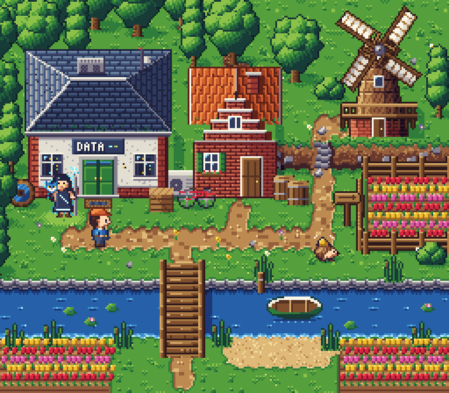

# Art direction: 16-bit console RPG (overworld test screen)

One test screen of the overworld, drawn the way a 16-bit console RPG of about 1990-1994 would draw it.
The scene is a Dutch-flavoured stretch of the plains: a forest edge, a small data hall and a brick
cottage, a canal with a wooden bridge and a moored boat, tulip fields in rows, a windmill on a raised
bank, dirt paths, fences and props. The player (an engineer with a tool belt), Ilatea the guide with her
owl Byte, and a villager (a hedgehog wearing its bicycle bell as a hat) stand in it.



| | |
|---|---|
| Native resolution | 256 x 224, shown at integer scales only (nearest neighbour) |
| Tiles | 16 x 16; the screen is 16 x 14 tiles; 250 unique tiles over 4 water frames |
| Sprites | characters 16 x 24 (the guide 22 x 30 with her stylus), owls 16 x 16, trees 32 x 42 |
| Palette | 63 colours plus transparent, in 15 ramps (`assets/palette.json`) |
| View | 3/4 top-down, light from the top-left everywhere |
| Movement | whole pixels only |

Screenshots: `docs/screenshots/art/sixteen/`: `scene-1x.png` (native), `scene-3x.png`, `portrait.png`,
`owls.png`, `walk-sheet.png`, `walk.gif`, `scene.gif` (water, sails, tulips, reeds, the walk), `sheet.png`
(every sprite and frame).

## How it is built

Everything on screen is indexed pixel data. Nothing is drawn with shape or fill calls at run time.

| File | What |
|---|---|
| `tools/sprites.txt` | hand-drawn sprites, one character per pixel with a legend per sprite: the player's three views and leg sets, Ilatea, the hedgehog, Byte and Nocti |
| `tools/pix.py` | the palette and its ramps, the shadow and glow look-up tables, a small indexed canvas |
| `tools/author.py` | draws the terrain, trees, buildings, windmill, sails, props and portrait pixel by pixel with the material ramps, lays out the scene, cuts the ground into 16 x 16 tiles, and writes `assets/` |
| `assets/palette.json` | colours, ramps, `darker` / `lighter` / `glow` tables (one ramp step) |
| `assets/tiles.json` | the tile set and a tile map per water frame (cells that change between frames are the animated tiles) |
| `assets/sprites.json` | every sprite frame as rows of palette indices |
| `assets/scene.json` | the objects of the screen: position, anchor, animation, shadow |
| `lab.js`, `index.html` | the renderer and the page: composes into a one-byte-per-pixel framebuffer like a console's tile and sprite layers, then applies the palette |
| `render.mjs` | renders the screenshots and GIFs (Playwright, headless chromium; ffmpeg for the GIFs) |

```sh
cd web
python3 art-lab/sixteen/tools/author.py      # rebuild assets/ (deterministic: same input, same bytes)
npx vite                                     # then open http://127.0.0.1:5173/art-lab/sixteen/
node art-lab/sixteen/render.mjs              # write docs/screenshots/art/sixteen/ (needs ffmpeg for the GIFs)
```

The page is self-contained: it shares no code with the game.

## Techniques

- **Ramps with hue shift.** Each material has 3 to 6 steps. Shadows lean blue-purple, highlights lean
  warm: grass runs from blue-green `#173b37` to yellow-green `#c8e070`; earth from plum `#3d2228` to
  cream `#f2dca0`; water from navy to pale cyan. Outlines are the darkest step of the material they
  surround (dark green round canopies, dark brown round wood, dark slate round the roof), never one black
  for everything.
- **One light.** Everything is lit from the top-left. Canopies, the barrel, the windmill's facets, the
  roof planes, window glints and pebbles all follow it. Cast shadows fall to the lower right and are a
  palette remap (one ramp step darker), so a shadow on grass is darker grass and on the path is darker
  earth, as with the colour maths of the period.
- **Terrain.** Four seamless grass tiles (blade strokes with lit tips, glints, clover, sparkles) are
  mixed by a fixed hash. Paths are a network: neighbouring path tiles are joined centre to centre, which
  gives a constant width with rounded joins. Path edges are recessed: the top and left rims are in
  shadow, the bottom and right rims are lit, and blades hang over the top edge. Water has a stone quay on
  the north bank (coping, two courses of blocks, a dark waterline), foam on the other banks, a
  bridge shadow, and ripple dashes that drift. Sand meets the water with a wet line and the grass
  with a short dither. A 16 px earth bank with bedded stones, a ragged grass lip and stone steps raises
  the windmill's plateau, with a shadow at its foot. All edges depend only on the local situation and a
  wobble that repeats every 16 px, so the same edge situation gives the same tile.
- **Detail.** Daisies, violets, buttercups, tufts and stones are scattered; the flowers and tufts sway
  in two frames.
- **Depth.** Trees are layered domes (each clump lit on its own) with a dark seam where a clump sits under
  the one above; they overlap the row behind. Objects are drawn in order of their base line.
- **Buildings in 3/4 view.** The data hall has a hipped slate roof with four planes (the lit back slope,
  the front slope, a lit west hip and a shaded east hip), a cooling unit and a mast on the roof, render
  walls with brick pilasters and plinth, windows that show a lit rack, a sign, a green double door with a
  step and a door mat. The cottage has a stepped gable with white coping, a pantile roof (lit west slope,
  shaded east slope, the gable's shadow on it, moss), a chimney, green shutters and a window box. Wear:
  render stains under the sills, worn slates, moss along the eaves.
- **Animation.** Water: 4 frames. Sails: 8 frames for a quarter turn (the sails are four-fold
  symmetric, so the loop is seamless). Tulips: 4-frame sway with a phase per plant. Reeds, flowers and
  the boat: 2 frames. Player: 4 directions x 4 frames (legs apart on the strides, body one pixel lower,
  one hand rising). Ilatea: idle frames and talk frames. Hedgehog: an idle bob with its bell ringing. Ilatea: her circuit lines and the stylus
  tip pulse over 4 frames, with a dithered aura.
- **Characters at native size.** The player: an orange cap, dark hair, blue work shirt, tool belt with a
  buckle and a tool. Ilatea: dark hair with a silver strand, gold eyes, a dark chiton with a glowing
  sash and hem, the stylus with a glowing tip, Byte on her shoulder (blue and white, yellow eyes), a
  glow on the ground. The owls: Byte blue and white, Nocti brown and black, each perched and flying.
- **Portrait.** 64 x 64 for the dialogue box: hair built from tapered clumps lit on their left edge with
  a sheen across the crown and silver strands that glint like fibre, a shaded face with owl-gold eyes and
  a calm smile, a glowing circlet, a chiton with circuit traces, her aegis as a hexagon clasp, the stylus
  tip tracing a glyph, a marble column, a stream of light and a rack with lights behind her.
- **Dither** only where a gradient needs it: the edge of cast shadows, the guide's glow, the cliff's
  foot shadow, the lightest two steps of the canopies, the stream of light in the portrait.

## Revision passes

Each pass: render, look at the 3x screen and close crops (path edges, water edge, canopy, buildings,
characters), list the five worst weaknesses, fix them, render again.

1. **First render.**
   Weaknesses: the guide read as a pale ghost; the windmill's sails ran off the top of the screen; the
   cottage roof was a flat slab and its stepped gable was lost in the brick; the bridge looked like a
   ladder; the grass had dithered squares that showed the tile grid, and the water sparkled like noise.
   Fixes: darker chiton; the plateau and mill moved down with shorter sails; the cottage redrawn (steps
   with white coping, the gable's shadow on the roof, a roof with lit and shaded slopes); a wider bridge
   with side beams, a railing and posts; grass dither replaced by glints and clover; calmer ripples. The
   data hall's sign, hidden under the eaves, moved onto a taller wall.
2. **Second render.**
   Weaknesses: paths swelled into blobs where they met; the raised bank read as a low stone wall; a
   vertical circuit line on the guide's chest read as a letter; a large flat patch of sand; no shadow
   under the bridge.
   Fixes: paths as a network of constant width; the bank became a 16 px earth face with bedded stones, a
   ragged grass lip, stone steps and a foot shadow; a diagonal sash on the chiton; the sand reduced to a
   strip at the water's edge; the bridge shadow on the water.
3. **Third render.**
   Weaknesses: the windmill was plain and its sails were blobby; the player's cap and hair merged into one
   orange shape; the canal was a long, empty band; the steps were too bright; the guide's arms stuck out
   and her owl read as a flower.
   Fixes: the windmill redrawn as an octagon of flat thatch facets with binding lines, a brick base, a
   stage with railing and struts, a shingled cap with a windboard, and cleaner lattice sails; darker hair
   under the cap; reeds with cattails, lily pads, a moored rowing boat and a mooring post; steps in mid
   greys with earth cheeks; the guide redrawn with her arms down and the spear in her hand, Byte drawn
   as a small owl (ear tufts, white face, yellow eyes), a dithered aura.
4. **Portrait and walk.**
   Weaknesses: the portrait's hair was diagonal stripes, the face too broad, the eyes narrow slits, the
   circuit lines formed digits, the background was busy; the walk had stiff arms.
   Fixes: hair from tapered clumps with light on the whole mass from the top-left and a short sheen arc;
   a narrower face with a jaw line on the shadow side; 4-pixel eyes with a lash line, gold iris, dark
   centre and glint; one trace along the neckline with short drops to glowing nodes; a calmer stream of
   light; a hand that swings on each stride.
5. **Composition.**
   Weaknesses: the plateau was an empty green field; the cottage's pantiles lined up into vertical
   stripes; the buildings cast no shadow; the fence stood on the face of the bank.
   Fixes: a poplar, a tree, flowers and a stone on the plateau; staggered pantiles with a curled lower
   lip; shadows to the lower right of the data hall, the cottage and the windmill; the tulip field and
   its fence moved down off the bank.

## Where it still falls short

- The portrait is the weakest piece: the hair is believable but stringy, and the face is good at
  dialogue size rather than striking. A hand pass on the hair clumps and the mouth would lift it.
- The bridge is still plain: a straight plank deck. An arched or lifting bridge would say "Dutch canal"
  more clearly.
- The player has one face for the walk; there is no blink frame yet. Ilatea's talk frames only open the
  mouth by a pixel.
- The terrain set covers what this screen needs (grass, path, water with quay and foam, sand, field soil,
  a raised bank with steps). Inner and outer corners of the bank at other angles, and other terrains, are
  not drawn yet.
