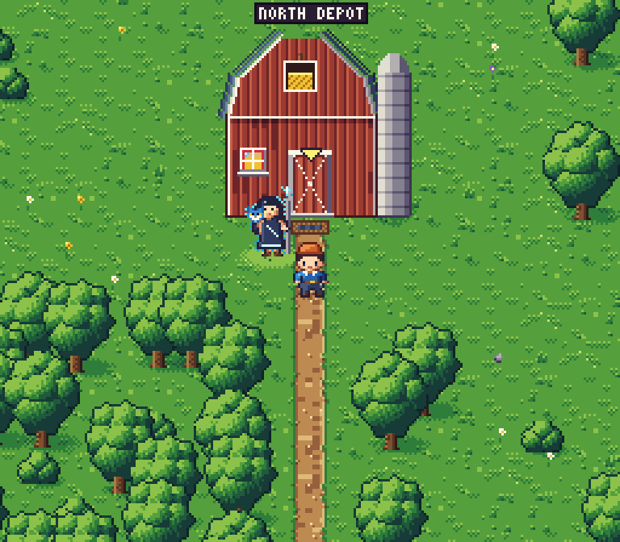

# The overworld: engine, map and art

The overworld is drawn in the 16-bit style of the art lab (`web/art-lab/sixteen/`): 256 x 224 native, 16 x 16
tiles, characters 16 x 24, its 63-colour palette in ramps, light from the top-left, hand dithering, whole-pixel
movement, shown at the largest whole-number scale that fits the window.



Screenshots: `docs/screenshots/g1/g1a/` (`region-<theme>-1x.png` / `-3x.png` for every theme, `country-<code>-3x.png`
for every country set, `door-transition.png`, `portrait-pipeline.png`, `walk.gif`, `perf.json`). They are written by
`web/e2e/overworld.spec.ts` (`make e2e`) from the overworld sheet `world.html` (`make dev-fixtures`, then
`http://127.0.0.1:5173/world.html?theme=farm&country=NL&scale=3`).

## How it is built

| Piece | What |
|---|---|
| `author_world.py` | writes `web/src/game/world/assets/` (palette, tiles, sprites). Reuses the art lab's palette, canvas and hand-drawn sprites (`web/art-lab/sixteen/tools/`) by import, so the game and the lab share one pipeline. Deterministic |
| `ground.py` | the ground autotiles (below) |
| `buildings.py` | one building per theme and the Netherlands buildings, all front-facing (below) |
| `props.py` | country landmarks, villagers, the airfield placeholder, the door marker |
| `../portraits/` | the portrait pipeline (below) |
| `web/src/game/world/engine.ts` | the indexed framebuffer: tiles, sprites, palette-remap shadows and glow, the palette applied last |
| `web/src/game/world/render.ts` | a map through the engine: autotile ids per cell once, visible cells and sprites per frame, sorted by base line |
| `web/src/game/world/gen.ts` | the map from NetBox data (below) |
| `web/src/game/world/camera.ts` | the camera: follows the player in whole pixels, never leaves the player's region |
| `web/src/game/world/countries.ts` | country sets keyed by ISO 3166-1 alpha-2 code |

```sh
cd web
python3 art/overworld/author_world.py     # rebuild src/game/world/assets/{palette,tiles,sprites}.json
node art/portraits/portrait.mjs           # rebuild src/game/world/assets/portraits.json and portrait-pipeline.png
```

Nothing in the world is drawn with shape or fill calls at run time: every pixel comes from tile and sprite data.

### Ground autotiles

The map is a grid of terrain classes: grass, path, water, bridge (path over water), sand, tulip field, crop field. A
tile's pixels depend only on its class, its four neighbours (reduced to what that class cares about: grass only
asks "path, lower ground or grass") and a variant, so `ground.py` renders every combination once, through the art
lab's per-pixel rules on a 3 x 3 probe of tiles, and keeps the centre. The engine looks each cell's tile up by that
key. Water and fields have four frames (ripples drift, tulips and the crop sway). Tests check that every key a
generated map uses exists.

### The map from NetBox data

Same sites, same map, in any order (`web/tests/world-gen.test.ts`).

1. **Regions.** Sites with GPS are joined when they are within 250 km of each other, directly or through a chain
   of sites. Sites without GPS join the lowest-id site's region. Regions are ordered by their lowest site id.
2. **Walking scale.** Each site's offset from its region's centre is compressed logarithmically (6 tiles per
   doubling of distance beyond 10 km): a site 10 km out and one 200 km out are both a short walk. North stays up.
   Buildings that would overlap are pushed apart.
3. **Filling the space.** A forest border; a canal with a sandy bank, a moored boat and reeds (or a pond); paths
   joining every site of the region (a minimum spanning tree over the doors, routed around buildings, crossing water
   straight as a bridge); fenced fields; the country's landmarks and villagers; groves and single trees; flowers.
   How much goes down scales with the region's area.
4. **Distant regions** sit side by side on one map, but no path joins them and the camera never leaves the player's
   region. Each region of a world with more than one has an **airfield pad, a placeholder**: stepping on it takes
   the player to the next region's pad, until flights replace it.
5. **Collisions.** Buildings (except the door tile), water (except bridges), trees, fields with their fences,
   landmarks, villagers and the guide block the way. Walking onto a door enters that site's first room through the
   game shell's scene switcher; leaving puts the player on the tile in front of the same door.

### Country sets

Picked per region by its sites' most common country (`Site.country`: the site's `iso_country` custom field, else
its region's slug when that is a two-letter code; see `contracts/api.md`). Landmarks, flora, food and weather only;
villagers are native animals, sometimes with one silly prop (a hat, a tool, food or a vehicle).

| Code | Landmarks | Villager | Water, field |
|---|---|---|---|
| `NL` | windmill with turning sails, stepped-gable cottage, cheese cart, bicycles, poplars | a hedgehog wearing its bicycle bell as a hat | canal with bridges, tulips |
| `GB` | red telephone kiosk, pillar box, tea stall with a steaming pot, a small rain cloud | a badger in a bowler hat | pond, yellow crop |
| any other | a well, haystacks | a rabbit holding a carrot | pond, yellow crop |

### Buildings and roofs

Every building shows its front wall (door and windows) to the camera and its roof from the front and a little
above: the eaves edge or a gable end faces the viewer, the roof plane is foreshortened above the wall, the ridge runs
across the top. No roof is a flat plan seen from straight above.

| Theme | Building |
|---|---|
| `debug` | the art lab's data hall walls under a hipped slate roof seen from the front: slate courses run across, the lit west hip and the shaded east hip show as narrow strips, a cooling unit and a mast stand behind the ridge |
| `industrial-robotic` | a brick works with a saw-tooth roof: three gable ends face the viewer, each with a glazed light; a chimney stack, a roller door framed in hazard stripes, a robot-eye lamp |
| `farm` | a red timber barn, gable end to the front under a gambrel roof, white trim, a hay loft with a bale, a silo |
| `business` | a glass office: a curtain wall that catches the sky, a parapet with the flat roof deck seen just above it (plant, a skylight), a canopy over glass doors |
| `pagodas-nature` | a two-tier pagoda hall: plaster and red lacquer posts, two roofs with rolled tiles running down the slope and eaves that sweep up at the corners |

The eaves cast a two-pixel shadow on the wall below them (one ramp step darker), like every cast shadow here.

### Portraits

Ilatea's, Byte's and Nocti's dialogue portraits start as hand-written SVG at 768 x 768 (`../portraits/*.svg`, from the
traits in `docs/art/guide-ilatea.md`). `portrait.mjs` rasterises each in headless chromium, downscales it with an
area filter (exact box averages, 12x to 64 x 64 and 8x to 96 x 96), maps it to the palette with no dither (ordered
dither was tried and is shown in the sheet: it turned the skin and the background into noise at this size), using
only the ramps the portrait is painted with (a skin tone never lands on path earth), then applies the hand clean-up:
pixel edits stored as data in `../portraits/cleanup/<who>-<size>.json`, each step with its reason (brows as one line,
eyes as lash line / white / gold iris / pupil, the nose shadow, the smile and lower lip, glints on the silver
strands). `portrait-pipeline.png` shows source, raw downscale, both palette mappings and the cleaned result.

### Frame times

`web/e2e/overworld.spec.ts` walks the player in the real game at 768 x 672 (3x) with chromium's CPU throttled 4x and
writes `perf.json`: frame interval p95 17.4 ms (60 fps), composing a frame 2.7 ms median, 3.6 ms p95, no layout shift.

## Art notes

Each round: render, look at the 3x screens and close crops, list the five worst weaknesses against the style and the
front-facing roof rule, fix them, render again.

1. **First render** (the industrial site at the start).
   Weaknesses: path edges scalloped in a pattern that repeated every tile, so a long path read as a chain; the door
   marker sat on the door instead of above it; groves of trees stood in exact rows; water ripples formed a regular
   grid; the portraits' ordered dither turned skin and background into noise.
   Fixes: a calmer path wobble; the marker raised above the door frame; four variants of every path, water and sand
   tile, chosen per cell by a hash, with the wobble, pebbles and ripples keyed to the variant; grove trees nudged a
   few pixels off the tile centre and thinned; portraits mapped without dither.
2. **Portraits.**
   Weaknesses: the skin mapped onto path-earth and brick colours (blotchy yellow and orange patches); at 64 px the eyes
   were smudges, the brows and lash lines merged, the nose had no shadow, the mouth did not read; the silver strands
   lost their glint.
   Fixes: each portrait maps only to the ramps it is painted with; the hand clean-up pass on brows, eyes, nose, mouth
   and strands (stored as pixel edits with their reasons).
3. **Country sets and themes** (the Netherlands set, the pagoda).
   Weaknesses: the windmill's new skirt roof was a saturated orange band, brighter than the sails; the rain cloud
   floats with nothing under it; the tulip field's lower fence hides the last row; fields show no soil margin; no path
   leads to the windmill.
   Fixes: the skirt roof darkened one ramp step with a dark lip. The other four are left for later (below).

## Where it still falls short

- The rain cloud casts no shadow; landmarks are not joined to the paths; the tulip field's lower fence hides its last
  row.
- Phones get 1x (256 px wide) because only whole-number scales are used.
- The airfield pad is a placeholder: it moves the player between regions at once, with no flight.
- Ilatea's portrait face is long, and her hair is a dark mass with few clumps; the owls had no hand pass at 96 px.
