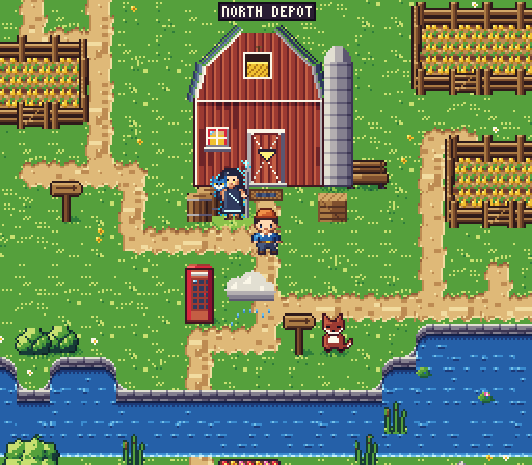

# The overworld: engine, map and art

The overworld is drawn in the 16-bit style of the art lab (`web/art-lab/sixteen/`): 256 x 224 native, 16 x 16
tiles, characters 16 x 24, its 63-colour palette in ramps, light from the top-left, hand dithering, whole-pixel
movement, shown at the largest whole-number scale that fits the window.



Screenshots: `docs/screenshots/overworld/` (`region-<theme>-1x.png` / `-3x.png` for every theme, `country-<code>-3x.png`
(the first landmark, the player in front of it) and `country-<code>-villager-3x.png` for every country set,
`door-transition.png`, `door-inside.png`, `door-back-out.png`, `portrait-pipeline.png`, `walk.gif`, `perf.json`). They are written by
`web/e2e/overworld.spec.ts` (`make e2e`) from the overworld sheet `world.html` (`make dev-fixtures`, then
`http://127.0.0.1:5173/world.html?theme=farm&country=NL&scale=3`).

## How it is built

| Piece | What |
|---|---|
| `author_world.py` | writes `web/src/game/world/assets/` (palette, tiles, sprites). Reuses the art lab's palette, canvas and hand-drawn sprites (`web/art-lab/sixteen/tools/`) by import, so the game and the lab share one pipeline. Deterministic |
| `ground.py` | the ground autotiles (below) |
| `buildings.py` | one building per theme and the Netherlands buildings, all front-facing (below) |
| `props.py` | country landmarks, villagers, the airfield placeholder, the door marker |
| `../portraits/` | the portrait pipeline (below) |
| `web/src/game/world/engine.ts` | the indexed framebuffer: tiles, sprites, palette-remap shadows and glow, the palette applied last |
| `web/src/game/world/render.ts` | a map through the engine: autotile ids per cell once (in the region's ground palette), objects filed in 128 px buckets, so a frame looks only at what is near the camera, sorted by base line |
| `web/src/game/world/themes.ts` | per-theme ground: palette remaps, flowers, how wooded |
| `web/src/game/world/gen.ts` | the map from NetBox data (below) |
| `web/src/game/world/camera.ts` | the camera: follows the player in whole pixels, never leaves the player's region |
| `web/src/game/world/countries.ts` | country sets keyed by ISO 3166-1 alpha-2 code |

```sh
cd web
python3 art/overworld/author_world.py     # rebuild src/game/world/assets/{palette,tiles,sprites}.json
node art/portraits/portrait.mjs           # rebuild src/game/world/assets/portraits.json and portrait-pipeline.png
```

Nothing in the world is drawn with shape or fill calls at run time: every pixel comes from tile and sprite data.

### Ground autotiles

The map is a grid of terrain classes: grass, path, water, bridge (path over water), sand, tulip field, crop field. A
tile's pixels depend only on its class, its four neighbours (reduced to what that class cares about: grass asks
"path, water, sand, field or grass") and a variant, so `ground.py` renders every combination once, through the art
lab's per-pixel rules on a 3 x 3 probe of tiles, and keeps the centre. The engine looks each cell's tile up by that
key. Water and fields have four frames (ripples drift, tulips and the crop sway). Tests check that every key a
generated map uses exists.

Shapes: water and sand are drawn from a field over the tile centres of the probe (the art lab's sand rule), so a
pond, a canal's end or a sand bank has rounded corners inside and out; sand gets a lumpy wobble and spills a pixel
or two onto the grass, water edges stay level for the quay. Paths wobble as much as the art lab's (the grass leans
over in clumps) and fill the inside corner of every turn and junction in a curve. The pond is an irregular blob,
the sand bank a lump, and the canal runs on under the forest border out of the picture.

### Themes on the ground

Each region is drawn in the ground palette of its sites' most common theme (ties: the alphabetically first; a site
without a known theme does not vote; none gives the plain ground). A ground palette is a remap inside the same 63
colours (`author_world.py` `GROUNDS`, applied by `themes.ts`): one table for grass and foliage (trees and flowers
too), one for path and sand earth; water, field soil, buildings and characters keep their colours.

| Theme | Ground |
|---|---|
| `debug` | the art direction's own meadow and earth track |
| `industrial-robotic` | dusty, darker grass; grey gravel paths; tufts and stones; fewer groves |
| `farm` | a warm late-summer meadow; a dry dirt track; buttercups |
| `business` | a smooth mown lawn; pale paving; few flowers; the fewest groves |
| `pagodas-nature` | deep moss green; blue-grey stone flags; violets; the most woodland |

### The map from NetBox data

Same sites, same map, in any order (`web/tests/world-gen.test.ts`).

1. **Regions.** Sites with GPS are joined when they are within 250 km of each other, directly or through a chain
   of sites. Sites without GPS join the lowest-id site's region. Regions are ordered by their lowest site id.
2. **Walking scale.** Each site's offset from its region's centre is compressed logarithmically (6 tiles per
   doubling of distance beyond 10 km): a site 10 km out and one 200 km out are both a short walk. North stays up.
   Longitudes wrap at the 180th meridian. Sites without GPS stand in a square block below the others. Then each
   site, nearest the centre first, takes the free place nearest its own, so buildings never overlap, however many
   sites share one point (200 sites at one point make a region about 200 tiles square).
3. **Filling the space** (design rule 18: no empty world; the bar is the art direction's scene). A forest border; a
   canal with a sandy bank, a moored boat and reeds, or a pond with a stream running from it out under the forest
   (east-west, so paths cross it on bridges), with reeds and lily pads; both a few rows below the first building, so
   the village has its water. Paths joining every site of the region (a minimum spanning tree over the doors, routed
   around buildings, crossing water straight as a bridge). Fenced fields of four to six by two or three tiles, each
   with a gate in its bottom fence. The country's landmarks and villagers. Then the dressing:
   - side paths from the network to the front of every landmark and to every field gate, and two lanes that leave
     the network for the woods, so the paths branch and meet;
   - a signpost at a junction, benches beside straight stretches of path, short fences along paths;
   - a yard in front of each building in its theme (crates, paired barrels, a cooling unit, a cable drum, a bench, a
     rock), on the front corners and against the east wall;
   - two-tile flower beds beside paths (warm colours; cool ones in the business and pagoda themes), rock clusters
     with small stones, clumps of bushes with flowers at their feet, patches of wildflowers;
   - tufts and flowers along the path verges; groves; single trees and pairs at uneven gaps, some with a bush.

   Fields, landmarks and the dressing go nearest the buildings first (a sweep from the doors), so the village round
   each door is the busiest part, and a steady scatter of rocks, bushes and flowers keeps the rest from going bare.
   How much goes down scales with the region's area.
4. **Distant regions** sit side by side on one map, but no path joins them and the camera never leaves the player's
   region. Each region of a world with more than one has an **airfield pad, a placeholder**: a label over it names
   where it goes, and stepping on it takes the player to the next region's pad, with a card saying where, until
   flights replace it. A canal that no path crossed gets one crossing, so both banks can be reached.
5. **Collisions.** Buildings (except the door tile), water (except bridges), trees, fields with their fences and
   gates, landmarks, villagers, the guide and every prop (signposts, benches, fences, yards, beds, rocks, bushes)
   block the way. A prop never stands on a path, a bridge, a door or the tiles kept free in front of a door, so every
   door stays reachable along the paths (`web/tests/world-gen.test.ts` walks it in every country set and theme). Walking onto a door enters that site's first room through the
   game shell's scene switcher; leaving puts the player on the tile in front of the same door.
6. **A saved place after an edit in NetBox.** Adding, moving or deleting a site, or changing its GPS or country,
   regenerates the map. A saved tile is kept only if the player can walk on from it to the region's doors (a reach
   map from every region's arrival tile); otherwise the player is put on the nearest such tile of the same region,
   or at the start.

### Country sets

Picked per region by its sites' most common country (`Site.country`: the site's `iso_country` custom field, else
its region's code or country name, else its address's last line; see `contracts/api.md`). Landmarks, flora, food and weather only;
villagers are native animals, sometimes with one silly prop (a hat, a tool, food or a vehicle).

| Code | Landmarks | Villager | Water, field |
|---|---|---|---|
| `NL` | windmill with turning sails (its brick base under a pantile skirt roof seen from the front, the door full height below it), stepped-gable cottage, cheese cart, bicycles, poplars | a hedgehog wearing its bicycle bell as a hat | canal with bridges, tulips |
| `GB` | red telephone kiosk, pillar box, tea stall with a steaming pot, a small rain cloud | a badger in a bowler hat; a red fox (second villager of a region with more than one site) | pond, yellow crop |
| any other | a well, haystacks | a rabbit holding a carrot | pond, yellow crop |

### Buildings and roofs

Every building shows its front wall (door and windows) to the camera and its roof from the front and a little
above: the eaves edge or a gable end faces the viewer, the roof plane is foreshortened above the wall, the ridge runs
across the top. No roof is a flat plan seen from straight above.

| Theme | Building |
|---|---|
| `debug` | the art lab's data hall walls under a hipped slate roof seen from the front: slate courses run across, the lit west hip and the shaded east hip show as narrow strips, a cooling unit and a mast stand behind the ridge |
| `industrial-robotic` | a brick works with a saw-tooth roof: three gable ends face the viewer, each with a glazed light; a chimney stack, a roller door framed in hazard stripes, a robot-eye lamp |
| `farm` | a red timber barn, gable end to the front under a gambrel roof, white trim, a hay loft with a bale, a silo |
| `business` | a glass office: a curtain wall that catches the sky, a parapet with the flat roof deck seen just above it (plant, a skylight), a canopy over glass doors |
| `pagodas-nature` | a two-tier pagoda hall: plaster and red lacquer posts, two roofs with rolled tiles running down the slope and eaves that sweep up at the corners |

The eaves cast a two-pixel shadow on the wall below them (one ramp step darker), like every cast shadow here.

### Portraits

Ilatea's, Byte's and Nocti's dialogue portraits start as hand-written SVG at 768 x 768 (`../portraits/*.svg`, from the
traits in `docs/art/guide-ilatea.md`), painted the way a 16-bit portrait is: flat tones (lit, base, shade) with a dark
outline, no soft gradients, framed close so the face fills the small sizes (Ilatea's scene is scaled 1.35x about her
face). Ilatea's hair is the guide's first variant: dark slate, flowing like streams of code, with a few silver strands
like fibre (the art direction's own colours for it, the slate ramp), never purple.

`portrait.mjs` rasterises each in headless chromium, downscales it with an area filter (exact box averages, 12x to
64 x 64 and 8x to 96 x 96), maps it to the palette with no dither (ordered dither is shown in the sheet for
comparison: it turns the skin and the background into noise at this size), using only the ramps the portrait is
painted with (a skin tone never lands on path earth), then applies the hand clean-up pass: pixel edits stored as data
in `../portraits/cleanup/<who>-<size>.txt`, one file for every portrait at both sizes, each step headed by its reason.
The format is one edit per line: `x,y colour` sets a pixel, `x0,y0 x1,y1 colour` a rectangle, `x0,y0 x1,y1 a>b`
recolours `a` to `b` inside a rectangle (or `x,y a>b` at one pixel), `## why` starts a step.

The clean-up starts from the no-dither mapping and only makes single, deliberate marks; nothing is drawn across the
skin. Ilatea: each eye a lash line with a dark wing at the outer corner, white corners, a gold iris round a black
pupil with a glint on its upper left and the lower iris lit; level brows in the hair's dark slate; the nose as one
shade step down its shaded side; a short smile with upturned corners; the face and neck outlined in dark skin instead
of grey; grey specks where hair and skin blended taken out. The owls: flat face discs (no specks), round pupils with a
glint, the sceptical lid of Nocti as one flat shape with one lit run, deliberate chevrons on the breast instead of
grey halos, Byte's beak with a clean outline and his sheen kept as one cyan arc. `portrait-pipeline.png` shows source,
raw downscale, both palette mappings and the cleaned result.

### Frame times

`web/e2e/overworld.spec.ts` walks the player in the real game at 768 x 672 (3x) with chromium's CPU throttled 4x and
writes `perf.json`: frame interval p95 17.5 ms (60 fps), composing a frame 2.6 ms median, 4.7 ms p95, no layout shift
(composing p95 was 3.2 to 4.7 ms over five runs on the dressed map, 2.8 ms before it). The dressing added about a
quarter more objects; a frame still looks only at the objects near the camera
(`web/tests/world-engine.test.ts` checks that a world of 200 sites looks at no more than a world of 3): in node,
unthrottled, composing a frame of a 200-site world (152,000 objects) takes 0.6 ms median, as for 3 sites. Building the
map of that world takes about 1.4 s once at load (0.8 s before the dressing; the side paths and lanes are routed per
region).

## Art notes

Each round: render, look at the 3x screens and close crops, list the five worst weaknesses against the style and the
front-facing roof rule, fix them, render again.

1. **First render** (the industrial site at the start).
   Weaknesses: path edges scalloped in a pattern that repeated every tile, so a long path read as a chain; the door
   marker sat on the door instead of above it; groves of trees stood in exact rows; water ripples formed a regular
   grid; the portraits' ordered dither turned skin and background into noise.
   Fixes: a calmer path wobble; the marker raised above the door frame; four variants of every path, water and sand
   tile, chosen per cell by a hash, with the wobble, pebbles and ripples keyed to the variant; grove trees nudged a
   few pixels off the tile centre and thinned; portraits mapped without dither.
2. **Portraits.**
   Weaknesses: the skin mapped onto path-earth and brick colours (blotchy yellow and orange patches); at 64 px the eyes
   were smudges, the brows and lash lines merged, the nose had no shadow, the mouth did not read; the silver strands
   lost their glint.
   Fixes: each portrait maps only to the ramps it is painted with; the hand clean-up pass on brows, eyes, nose, mouth
   and strands (stored as pixel edits with their reasons).
3. **Country sets and themes** (the Netherlands set, the pagoda).
   Weaknesses: the windmill's new skirt roof was a saturated orange band, brighter than the sails; the rain cloud
   floats with nothing under it; the tulip field's lower fence hides the last row; fields show no soil margin; no path
   leads to the windmill.
   Fixes: the skirt roof darkened one ramp step with a dark lip. The other four are left for later (below).
4. **Door marker, portraits again** (every theme at 3x, the six portraits at 10x with a pixel grid).
   Weaknesses: the door marker, raised above the door frame in round 1, now covered the sign over the door on every
   theme that has one ("DA▼--" on the data hall); Ilatea's face was long and her hair one dark mass; the owls, painted
   with soft gradients, came out mushy, Nocti's dark side was the same colour as its background, and Byte at 96 and
   Nocti at both sizes had no hand pass.
   Fixes: the marker bobs inside the upper half of the doorway, below the sign (a test keeps it there); the three
   sources repainted in flat tones with a dark outline, Ilatea's face shortened, her hair broken into lit clumps with
   one silver strand per side, the scene framed closer; Nocti against a slate-blue workshop wall, with a sceptical
   lid and a screwdriver; a hand clean-up file for every portrait at both sizes.

5. **Roofs, ground, portraits** (every theme at 1x and 3x, NL and GB at 4x, the portraits at 8x).
   Weaknesses: the windmill's skirt roof was painted over the top of its door (a 5 px stub, the knob gone); every
   theme had the same ground; the pond was a square pool, the sand bank a rectangle, paths ruler-straight with
   square inside corners, the canal ended square at the forest; the fields' side fences covered a third of the
   plot; Ilatea's eyes read as half-closed slits, and a straight light/shade line split her forehead.
   Fixes: the skirt roof on rows of its own (everything above the base moved up 4 px); per-theme ground palettes and
   flowers; rounded water and sand shapes, path wobble and curved corners, the canal under the forest; stacked side
   fences; her eyes open (two rows of gold iris, a glint on each pupil), the forehead light on a slant.

6. **Portraits from the no-dither mapping** (the six portraits at 10x with a pixel grid, beside the art direction's
   portrait).
   Weaknesses: the hand pass drew pale lines across Ilatea's face, brows and hair, so the cleaned portrait read worse
   than the plain mapping, worst at 96; her hair was purple, outside the guide's "dark, with silver strands"; her face
   had a grey outline; Nocti's face disc at 64 was speckled; the owls' pupils had no glint and Byte's discs a grey halo.
   Fixes: every clean-up file rewritten from the no-dither result with single marks only (above); the hair repainted
   in dark slate with short silver strands inside the mass instead of two long lines framing the face; a recolour
   edit for sweeping specks out of an area without touching anything else.
7. **Density** (every theme and country at 3x beside the art direction's scene; 6x crops of both).
   Weaknesses: open grass with one landmark and one straight path; no water in view of any building; no fences or
   gates except round the two fields; no props by the buildings; trees only in groves or alone at even gaps.
   Fixes: the dressing (above), fields and water placed near the village, side paths and lanes, uneven tree spacing.
8. **Density, second look** (same views).
   Weaknesses: three signposts in one screen; flower beds sat on the water's bank and on the fields' top fences; the
   flower bed was a thin strip; the stream left the pond with a notch of grass; stretches far from the doors were
   still bare.
   Fixes: at most one signpost per ten steps of path; no prop right above water or a field; a taller bed with a timber
   edge and three rows of flowers; the pond's corner joins the stream; a steady scatter of rocks, bushes and flowers
   away from the village; tufts and flowers along the path verges; barrels in pairs; the rain cloud, which now came
   down near the village with the other landmarks and hung over a doorway, keeps six steps from any door.

## Where it still falls short

- The rain cloud casts no shadow; the tulip field's lower fence hides its last row.
- The ground is flat: the art direction's scene has a raised bank with a stone wall and steps, which the map has no
  height for yet.
- A big world takes longer to build at load since the dressing (see Frame times).
- The pond's outline follows whole tiles, so its curves step at tile corners; the quay stones follow those steps.
- Nothing points at buildings off screen yet (a map and a marker to the next small fix come with the quest log).
- Phones get 1x (256 px wide) because only whole-number scales are used.
- The airfield pad is a placeholder: it moves the player between regions at once, with no flight.
- The portraits have no idle or talk frames yet.
